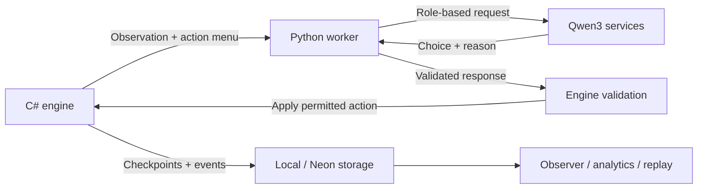

# GEarth

GEarth is a distributed, LLM-driven society simulation built for Knight Hacks IX. A C# engine maintains an authoritative world of 1,100 agents across ten fictional countries, while shared Qwen3 model services generate decisions for citizens, entrepreneurs, and institutions.

The simulation connects labor, production, banking, public services, trade, and diplomacy. A browser dashboard exposes world state, agent decisions, and recorded outcomes; a native Vulkan renderer replays saved runs.

[Devpost](https://devpost.com/software/diarockets) · [Dashboard](https://8-34-212-187.sslip.io/) · [Design](gearth-design.md) · [Contributing](CONTRIBUTING.md)

## Features

- **Agent-based economy:** Employment, weekly payroll, household consumption, competing firms, loans, taxes, healthcare, and education.
- **Country interactions:** Resource endowments, freight costs, cross-border shipments, diplomacy, infrastructure, and conflict.
- **Distributed inference:** Role-based routing to Qwen3-8B and Qwen3-4B across two NVIDIA DGX Spark systems and an AMD GPU.
- **Validated actions:** Engine-generated menus, bounded parameters, decision deadlines, and explicit rule-based fallbacks.
- **Persistence and inspection:** Local or Neon-backed checkpoints, ordered events, agent inspectors, and automatic run reports.
- **Experiments and replay:** Checkpoint-based alternate timelines, a saved-data explorer, Databricks analytics, and C++/Vulkan playback.

## Architecture

| Component | Technology | Responsibility |
| --- | --- | --- |
| Simulation engine | C# / .NET 10 | World state, economic rules, accounting, action validation, and simulated time |
| API and coordinator | ASP.NET Core | Decision scheduling, worker requests, persistence, and observer endpoints |
| Inference workers | Python / FastAPI | Prompt construction, model routing, response validation, and fallback handling |
| Model services | Qwen3-8B / Qwen3-4B | Institutional and entrepreneur decisions / resident decisions |
| Storage | Neon PostgreSQL or local files | Checkpoints, event history, and saved-run inspection |
| Browser observer | HTML / CSS / JavaScript | Country and agent views, event inspection, and experiment comparisons |
| Replay renderer | C++20 / Vulkan | Playback of exported checkpoints and events |
| Analytics | Python / Databricks | Audit exports, integrity checks, Delta tables, and cached reports |
| Deployment | Google Cloud | Shared simulation and observer hosting |

### Decision pipeline



The engine constructs each agent's observation and available actions. The model returns a numbered choice, a short explanation, and any required bounded integer values. The worker checks the response contract; the engine revalidates the action against current money, inventory, permissions, and state before applying it.

Model requests run asynchronously with provider-specific admission limits and one pending request per identity. Completed decisions apply in dispatch order. Timeouts, invalid responses, and fallback actions remain visible in recorded decision metrics.

Models share serving replicas across agent identities. Qwen3-8B handles institutional and entrepreneur decisions; Qwen3-4B handles residents. The Sparks use vLLM, and AMD serves Qwen through ROCm/PyTorch. See the [model setup](docs/gearth/18-all-node-qwen-setup.md) and [AMD batching guide](docs/gearth/25-amd-batch-optimization.md).

### Simulation timing and accounting

One tick represents one simulated day. Payroll runs every seven ticks. Governments, entrepreneurs, banks, newsrooms, and independently deciding state firms receive weekly turns; citizens rotate through eight weekly cohorts, and planners set plans every four weeks. The coordinator waits for the week's decisions before payroll and weekly reviews.

Money is recorded in integer minor units. The engine tracks transfers and escrow, validates resource availability, and records ordered events with cause references. Run reports distinguish accepted model actions, engine rules, and fallbacks.

## Quick start

### Requirements

- .NET 10 SDK matching [global.json](global.json).
- Python 3.12+.
- Git.
- Node.js for browser tests; Node.js 22+ for the renderer launcher.

### Run a local simulation

```bash
git clone https://github.com/liangricky7/GEarth.git
cd GEarth

python3.12 -m venv .venv
.venv/bin/python -m pip install -r agents/requirements.txt
cp .env.example .env.local

.venv/bin/python ops/run_stage1.py --world --storage local
```

Open [http://127.0.0.1:5080](http://127.0.0.1:5080/). This configuration uses deterministic rule-based decisions and requires no GPU endpoints or Neon credentials. On an existing installation, keep your current `.env.local`.

Ctrl+C stops the launcher and child services. After a run completes, the observer remains available unless `--exit-on-complete` is supplied.

### Enable live inference

Configure authenticated model endpoints and Spark SSH access in `.env.local`, following the [Qwen setup](docs/gearth/18-all-node-qwen-setup.md) and [AMD setup](docs/gearth/12-amd-compute.md). Set Neon credentials when using database storage.

```bash
.venv/bin/python ops/run_stage1.py --world --live --compute hybrid --storage neon
```

Use `--compute spark` or `--compute amd` for one hardware source, and `--storage local` for file-backed storage. Runtime credentials and local state are ignored by Git.

## Configuration

| Option | Default for world runs | Purpose |
| --- | --- | --- |
| `--population` | `1100` | Initial agent population |
| `--ticks` | `360` | Simulated days; use `365` for a full year |
| `--interval` | `2` | Requested delay between ticks, in seconds |
| `--seed` | `20261010` | Seeded initial conditions |
| `--capacity` | Derived from enabled providers | Cap concurrent live requests |
| `--government-rotation` | `0` | Rotate government assignments using values `0–4` |
| `--storage` | `neon` | Choose `local` or `neon` |
| `--no-analytics` | Analytics enabled for fresh world runs | Disable daily audit capture |
| `--verbose` | Off | Also write day-by-day renderer history |

Inference latency can extend tick duration. Concurrency limits describe admitted requests, not measured throughput or supported population.

Inspect a saved Neon run without resuming inference:

```bash
.venv/bin/python ops/run_stage1.py --storage neon --run-id YOUR_RUN_ID
```

## Experiments, analytics, and replay

What-if timelines fork a Neon checkpoint at its recorded log sequence number (LSN), preserving the source state and event history. A control fork and a changed fork can then be compared. The initial browser experiment implementation uses deterministic rule decisions and requires server-side Neon branch configuration.

```bash
.venv/bin/python ops/fork_run.py YOUR_RUN_ID --day 14 --country aster --government dictatorship
```

See the [timeline experiment guide](docs/gearth/26-timeline-experiments.md).

Fresh world runs capture daily analytics by default. Databricks imports are an explicit operator workflow; the observer reads cached reports and datasets. Exports preserve run identity, sequence boundaries, and source hashes. See the [analytics pipeline](docs/gearth/20-analytics-pipeline.md), [analytics contracts](analytics/README.md), and [saved-data explorer](docs/gearth/26-run-data-explorer.md).

For native replay, build the renderer, export a completed run, and package its states and events into a single `.gearth` recording:

```bash
.venv/bin/python ops/export_renderer.py YOUR_RUN_ID artifacts/local/replay --api http://127.0.0.1:5080
node renderer/recording.mjs artifacts/local/replay artifacts/local/replay.gearth
node renderer/run.mjs --export artifacts/local/replay.gearth
```

The renderer requires a Vulkan 1.3 GPU and a desktop surface. Build instructions and platform support are documented in [renderer/README.md](renderer/README.md).

## API

The observer reads run-scoped endpoints from the ASP.NET Core API.

| Endpoint | Returns |
| --- | --- |
| `GET /api/health` | Current run status |
| `GET /api/runs` | Available runs |
| `GET /api/runs/{id}/snapshot` | World snapshot |
| `GET /api/runs/{id}/events` | Events with sequence-based pagination |
| `GET /api/runs/{id}/agents` | Filtered, paginated agent list |
| `GET /api/runs/{id}/agents/{agentId}` | Individual agent details |
| `GET /api/runs/{id}/notes` | Structured run report |

## Testing

```bash
dotnet test GEarth.sln
.venv/bin/python -m pytest agents analytics/tests ops/test_amd_model_server.py ops/test_amd_batch_server.py ops/test_compute_config.py ops/test_spark_qwen.py -q

npm ci
npm run test:observer
npm run test:data
npm run test:renderer

.venv/bin/python docs/gearth/validate_design.py
.venv/bin/python ops/check_scheduler_integration.py
```

Tests cover economic rules, accounting, scheduling, persistence, worker validation, analytics, and observer behavior. A full-year rule-based calibration test checks the economic loop. Synthetic inference tests do not qualify live GPU performance.

For a completed run being served, `ops/check_world.py` checks accounting conservation, durable events, checkpoint readback, and API bounds. Add `--require-model` to require real model turns and `--require-full-coverage` to qualify decision-maker coverage.

## Repository structure

```text
backend/
  GEarth.Core/       Simulation rules, state, accounting, and scheduling
  GEarth.Api/        Coordinator, persistence integration, API, and observer
  GEarth.Tests/      Engine and API tests
agents/              Python inference workers and provider routing
analytics/           Audit exports, validation, and Databricks notebooks
renderer/            Native Vulkan viewer and recording tools
ops/                 Launchers, deployment, hardware setup, and run checks
docs/gearth/         Runbooks, contracts, fixtures, and validation evidence
```

## Documentation

- [Design and simulation rules](gearth-design.md)
- [World operation](docs/gearth/08-world-runbook.md)
- [Google Cloud deployment](docs/gearth/22-google-cloud-deployment.md)
- [Model and worker setup](docs/gearth/18-all-node-qwen-setup.md)
- [AMD inference and batching](docs/gearth/25-amd-batch-optimization.md)
- [Contribution workflow](CONTRIBUTING.md)

GitHub updates and deployed releases are separate; follow the deployment runbook to activate changes on the shared VM.

## Limitations and planned work

Countries and outcomes reflect a configured fictional society. Seeded initial conditions do not make live LLM trajectories deterministic. Rule-based calibration and hardware admission settings do not establish a sustained live population limit; the 50,000-agent annual workload remains unqualified.

Next steps include live-AI what-if experiments, more controlled scenarios, richer replay, and sustained inference benchmarks that measure accepted decisions, latency, fallback rate, and population coverage.

## Team and awards

Built by **Ricky Liang, Ahmad Hijazi, Jayden Hong, and Kennedy Nguyen** for **Knight Hacks IX**.

Awards listed on [Devpost](https://devpost.com/software/diarockets):

- **BNY:** Financial Services Challenge
- **AMD:** Best Use of AMD Technologies
- **Neon:** Best Use of Neon
