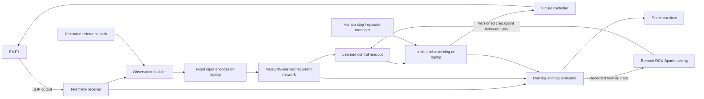

# System design

Historical/supporting document. Use [10 — execution roadmap](10-implementation-roadmap.md) and [11–13 — current contracts](11-implementation-contract.md) for build decisions. Earlier schedules, inputs, data quotas, and learning recipes below do not add requirements to that plan.

Revision note: use [document 08](08-research-roadmap.md) for simulator selection, [document 09](09-fixed-circuit-controller.md) for controller rationale, and [document 11](11-implementation-contract.md) for authoritative implementation contracts. The graph dynamics, hardware split, provenance, and deployment checks below remain supporting design material. EA-specific adapter fields describe an alternative, not the current default.

All timings and sizes below are proposed targets to validate on hardware.

For the concrete network recipe, use [document 12](12-fly-network-specification.md). Its artificial topology-based input mapping and sampled downstream outputs supersede the population-mapping suggestions below for version 1.

## Runtime architecture

The Spark is confirmed remote over the internet. Default to keeping the game, telemetry receiver, observation builder, full fly-policy inference, controller, and watchdog on the Windows laptop. Use Spark for graph preparation, training, and offline experiments; transfer data and versioned checkpoints between runs. This isolates driving from internet jitter, but full-graph laptop performance is an open gate. Attempt the same full sparse rate network locally before considering reduction.

If the full network misses local deadlines, first test local sparse-kernel changes and fewer internal updates, then explicitly qualify a changed cadence or reduced graph. Remote Spark inference is a separate optional experiment requiring sustained round-trip tests, including p99 and disconnect behavior; a low average ping alone is insufficient. A reduced or distilled deployment must be labeled accurately; a conventional distilled student is not the full fly network.

## DGX Spark deployment and feasibility

NVIDIA's guide describes an ARM64 CPU, a Blackwell GPU, unified memory, and CUDA/container tooling. Verify the actual unit's memory and installed stack before pinning dependencies. Use ARM64-compatible packages/containers with supported Blackwell kernels; do not assume an x86 CUDA environment will run unchanged. [NVIDIA system overview](https://docs.nvidia.com/dgx/dgx-spark/system-overview.html)

The extra memory makes the full sparse graph a more credible first experiment. It does not establish real-time performance: sparse recurrent graph updates can be dominated by memory access and kernel overhead. NVIDIA's advertised FP4 tensor throughput is not a benchmark for this model. [NVIDIA specifications](https://www.nvidia.com/en-us/products/workstations/dgx-spark/)

Keep graph weights and state resident on the inference device, normally the laptop. Export portable tensors and graph metadata from Spark rather than platform-specific executable artifacts; pin preprocessing, node order, dynamics, and framework versions. Compare a recorded sequence on both hosts within declared numeric tolerances before deployment. Load a checkpoint only between episodes, validate its hashes, and retain the last known working checkpoint.

Under optional remote inference, send only compact observations/actions during control and sample pooled activity for the dashboard at a lower rate. Transfer demonstrations and checkpoints outside the latency-critical stream. Keep the controller watchdog entirely independent of the network/model service.

For a rough storage estimate, CSR with float32 weights and int32 indices uses about `8E + 4(N+1)` bytes for N nodes and E aggregated directed edges. Illustratively, 25 million edges require about 200 MB for that matrix alone; this is not a measured MaleCNS import size. Intermediate representations, graph copies, batches, optimizer state, and recurrent training activations require additional memory. Never allocate a dense N-by-N matrix. Measure peak usage and latency rather than infer them from node counts.

Before committing to the architecture, measure graph load time, retained counts, peak memory, and single-step/complete policy p50/p95/p99 latency on both machines, plus game frame rate with local inference active. Measure internet round trip and jitter only to qualify the optional remote path. Spark training can proceed while a frozen checkpoint drives locally. If using remote inference, separate Spark training and live evaluation windows so neither resource contention nor weight updates change the scored policy.

For optional remote inference, use a persistent versioned message channel with bounded queues, initially a simple reliable connection. Drop obsolete observations before transmission/inference rather than draining a growing backlog. Every request/response carries episode ID, observation sequence, schema version, and checkpoint ID. A response echoes the laptop's request sequence; the laptop determines expiry using its own monotonic clock. Never subtract monotonic timestamps from different machines.

Allow one ordered recurrent stream per episode. On disconnect, unexpected sequence gaps, or session changes, release controls, invalidate the attempt, and restart the stream from an acknowledged state reset; a recovered connection must not resume stale hidden state. Lost responses and delayed messages cannot re-arm the controller. Bind the service to the intended private network or authenticated remote channel, not an unauthenticated public endpoint.

EA publishes UDP **output** specifications; these are not a game-control or reset API. Input must use a separately verified controller path. The published F1 25 and 2026 formats differ, so select the protocol for the installed edition explicitly. [EA specification hub](https://forums.ea.com/blog/f1-games-game-info-hub-en/ea-sports%E2%84%A2-f1%C2%AE25-2026-season-pack-udp-specification/12187347)

## Components and contracts

| Component | Responsibility and output |
| --- | --- |
| Telemetry receiver | Validate packet length, format, type, session, and player index; retain raw packets and local monotonic receive timestamps |
| State assembler | Assemble freshest compatible fields; expose source timestamp and age per required packet group |
| Observation builder | Convert units, construct path-relative features, normalize with saved training statistics |
| Fly policy | Consume observation and recurrent state; emit action and new state |
| Controller adapter | Convert normalized action to calibrated stick/triggers; acknowledge issue time |
| Episode manager | Track idle, armed, running, terminated, reset-pending; initialize policy state only on explicit episode boundaries |
| Evaluator | Determine completion and validity from game telemetry, corroborated by game UI during validation |
| Recorder | Persist observations, intended/issued/observed actions, timing, interventions, and results |

Proposed records:

- `Observation`: run/episode/session IDs, sequence, game time, receive time, required-field ages, speed in m/s, heading error in radians, lateral error in metres, lookahead offsets, prior issued action, validity mask.
- `Action`: observation sequence, policy version, compute completion time, steering in [-1, 1], throttle/brake in [0, 1], expiry time.
- `EpisodeResult`: outcome, completed distance, game lap time in milliseconds when available, validity reason, intervention flag, settings hash, checkpoint hash.

Do not replace missing values with plausible zeros. Never act on another car's data. Handle packet loss and out-of-order arrival without rewinding state; clear buffers on session changes and reject unsupported schemas.

## Observations and track knowledge

Start with speed, path-relative lateral/heading errors, a handful of lookahead path points in car coordinates, and the previous issued action. Add yaw rate only if the selected protocol supplies it reliably. Keep absolute lap time and the target time out of the controller initially.

Record a clean human-driven reference path as world positions with lap progress. Resample it by distance and compute local tangents. Track nearest progress within a continuity window so adjacent track segments cannot cause jumps. Use lap wrap handling and explicit lost-localization detection.

This path is a demonstrated driving line, not a surveyed track centerline. Distance from it does not establish track-limit validity. Nor should the design assume UDP supplies track edges, future curvature, or camera pixels. The initial policy uses known-track information; it is not a screen-only agent. Geometry comes from the recorded path, while official lap validity comes from the game.

## Fly-network proposal

Use MaleCNS v1.0 connectivity and annotations, pinned to downloadable files and hashes. Import directed neuron-to-neuron connections, aggregate repeated synaptic contacts, and retain original IDs. Report synaptic-contact counts separately from aggregated graph-edge counts. Dataset access and downloads are documented by Janelia. [MaleCNS downloads](https://male-cns.janelia.org/download/)

The first experiment uses a **fixed sparse recurrent rate network** as a feature generator, with a small trained readout. This trades biophysical fidelity for an implementable control experiment:

`h_next = (1 - alpha) * h + alpha * tanh(g * A * h + B * x + b)`

`action = bounded_readout(pool(h_next))`

Here `A[i,j]` sends neuron j's activity to neuron i; it comes from aggregated connectivity with a documented normalization and sign rule. Synapse counts are not direct measurements of functional synaptic strength. Predicted transmitter labels may inform a simplified sign assignment; unknown or ambiguous labels need an explicit policy and reported counts. Do not present that assignment as measured electrophysiology.

`B` is a fixed, seeded sparse input mapping, preferably restricted to documented candidate input populations. Pool a documented set of output populations into a small feature vector. Both mappings are artificial sensory/motor interfaces. Confirm directed paths from injected populations to readout populations and choose enough internal updates for information to propagate within the latency budget. Do not assume a biologically named population automatically encodes steering or speed.

Train the readout first; keep `A`, `B`, pooling, gain, leak, and dynamics fixed within an experiment. Check saturation, dead states, sensitivity to changing observations, and recurrent stability before fitting. No direct observation-to-action bypass exists in the primary fly-policy condition. Any added bypass must be a separately labeled hybrid experiment.

Benchmark the full retained graph first. If it misses the deadline or exhausts memory, use an explicitly documented connected subgraph with retained paths, a reproducible selection rule, and disclosed omissions. Do not silently swap MaleCNS for FlyWire. Full biological spiking dynamics and end-to-end training are stretch alternatives, not weekend prerequisites.

## Controls and timing

Current proposed control rate: 25 Hz, a 40 ms cycle, as specified in document 11. Aim for p95 observation-build plus policy plus controller-issue latency below 30 ms and p99 below 40 ms while the game runs; measure telemetry age, missed deadlines, and actual game frame rate separately. An optional remote experiment must include internet round trip in that total. These are qualification targets, not predictions. Start with a fixed number of recurrent updates per cycle. Do not assume neural simulation time equals game time.

`vgamepad` is an unapproved candidate Windows analog controller adapter, not a confirmed EA F1 integration. Its Windows dependency, ViGEmBus, is retired. Resolve the [EA anti-cheat assessment](06-ea-anticheat.md) before selecting this adapter; ordinary controller recognition is not evidence that autonomous use is permitted. [vgamepad](https://github.com/yannbouteiller/vgamepad), [ViGEmBus status](https://github.com/nefarius/ViGEmBus)

Keep the policy interface independent of EA: observations in, normalized controls out, episode status back. This allows a simulator with an explicit agent interface to replace the EA adapter if needed. A switch would require new observation mapping, training, and benchmark validation; it is not a claim of automatic policy transfer.

Calibrate steering sign, deadzones, saturation, trigger ranges, and game filtering. Log issued values as well as the game's observed controls. Bound all outputs, limit steering slew, and resolve conflicting throttle/brake with a documented rule. Use the same rules in every baseline.

An independent controller watchdog releases all controls when actions expire, required telemetry becomes stale (initial threshold 200 ms), the policy fails, or the human stop is pressed. A late result must not restore an expired action. Return to idle and require re-arming. Neutral release does not stop a moving car instantly; terminate the attempt and let the operator pause/reset. Verify crash and lost-focus behavior on the actual host.

Manual menu resets are acceptable for the MVP. Never assume save-state restore, accelerated simulation, deterministic stepping, or unattended resets exist. Human actions during a scored lap invalidate autonomy; preparation between attempts is allowed.
