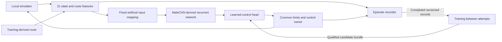

# Fixed-circuit fly controller: rationale

Supporting rationale only. [10 — roadmap](10-implementation-roadmap.md) owns priorities and schedule, [11 — implementation contract](11-implementation-contract.md) owns interfaces and comparison controllers, [12 — network specification](12-fly-network-specification.md) owns graph/dynamics/readouts, and [13 — hybrid learning](13-hybrid-learning-plan.md) owns training. This document intentionally does not repeat competing recipes.

## Why a fixed circuit helps

One car, one circuit, one setup, and fixed conditions reduce the variation the controller must handle. A known reference route supplies position around the lap and upcoming geometry. It does not supply the correct action for every approach: different speed, heading, or lateral position can require a different correction.

A timeline of button presses can diverge after a small error. The fly-derived policy instead receives current state and route-relative features every tick. Repeated routes make the experiment smaller; successful driving still requires feedback. A real driver's final lap time provides a benchmark, not demonstrations, a racing line, or a frame-by-frame ghost.

## Runtime data path

The graph participates in producing actions. The main fly policy has no raw-observation bypass or hidden reference-speed controller. The non-fly baseline is a separately labeled direct-feature MLP using the same permitted observations and action limits.

The 21-feature contract includes lap phase, forward/lateral velocity, route deviation, heading error, lookahead geometry, previous final actions, control interval, and telemetry age. Yaw rate, gear, and reference speed are not actor inputs in this version. Extra diagnostic telemetry can be recorded without being supplied to the actor; any input extension requires a schema change and fresh qualification.

## Why the biology still needs engineering

A connectome supplies wiring. It does not specify a unique neuron equation, input mapping, controller output, or learning rule. We use fixed signed recurrent dynamics and an artificial interface, with learned outputs. These assumptions must be disclosed and tested. [Official MaleCNS resource](https://male-cns.janelia.org/download/)

Importing the full retained-neuron graph does not establish that every neuron contributes to an action. Measure directed reachability and effective input response. Disabling propagation establishes a dependency by construction; a stronger claim about superior biological wiring requires a matched retrained control. See [14 — biology primer](14-fly-biology-and-model-review.md).

## Learning and recovery

Demonstrations initialize driving, a bounded RL pilot can improve the controller from its own experience, and human corrections remain available. Updates are separate candidates installed between attempts. Neural activity evolves within a lap; learned weights remain fixed during each evaluated attempt.

Test connected corners rather than isolated best splits. Retain earlier demonstrations so correcting one failure does not consume all training attention. Promote using completion and whole-lap outcomes, with rollback when results are inconclusive. The detailed reward, action probabilities, boundary handling, and experiment limits are in documents 10 and 13.

## Hardware and data economy

Game control and inference stay on Windows. Spark prepares the graph, replays data, and trains candidates; file transfer is outside the steering loop. A qualified small-head local training fallback between attempts is permitted when it reduces turnaround, without changing the algorithm or reporting.

Use compact feature caches rather than full neural-state recordings. As an illustrative storage calculation, 45,000 frames of 128 float32 features occupy about 23 MB before metadata; 166,000 states at every frame would occupy about 30 GB. The 166,000 figure here is a rounded illustration, not our unmeasured retained population. Keep raw observations and provenance so caches can be rebuilt.

## What the final result means

A completed valid lap shows that this engineered fly-derived controller operated this car on this circuit under declared settings. It does not demonstrate natural fly racing ability or general driving competence. Improvement over the imitation checkpoint supports a learning result; extra correction data must be disclosed when attributing that improvement.

The headline remains a valid lap below the predeclared published professional time, labeled as a cross-simulator comparison. Report the remaining gap if it is not reached. The roadmap's section-control and completion milestones preserve useful evidence without redefining the headline objective.
