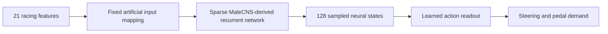

# Fly-network specification, version 1

Status: proposed, October 5, 2026. No graph has been imported or benchmarked. This document specifies the network recipe and replaces open-ended network choices in earlier drafts. [11 — implementation contract](11-implementation-contract.md) still controls observation order, episode lifecycle, deployment, and evaluation. Numerical values below are engineering starting points, not biological measurements or validated racing settings.

[Document 13](13-hybrid-learning-plan.md) adds RL and optional corrections to demonstration initialization. The 258-coefficient readout below is the initial imitation baseline; the RL learner adds exploration/value components and is not limited to that total parameter count. The graph remains fixed initially in both modes.

## What we are building

A connectome-derived recurrent reservoir with artificial racing inputs and a trained action readout. Here the fixed recurrent graph creates features from current/recent inputs; its usefulness for driving is an experiment, not an established property. See [14 — biology and model review](14-fly-biology-and-model-review.md) for the distinction between this architecture, biological learning, and a validated neural emulation.

Google's linked release is a wiring map of the male central nervous system, including brain and ventral nerve cord. It is not a pretrained game-playing model. [Google Research](https://research.google/blog/a-connectomics-milestone-mapping-the-complete-male-fruit-fly-brain/)

Shiu and colleagues provide a useful computational-model precedent, but their implementation uses FlyWire IDs and spiking dynamics. It is not a ready-made MaleCNS controller. Our rate network is a distinct engineering model. [Authors' implementation](https://github.com/philshiu/Drosophila_brain_model)



## 1. Pin the source and retained population

Use MaleCNS v1.0 and the following official download entries. Preserve filenames and hash the actual files during import. The release page labels the connectivity table as segment-to-segment data, so its row population must not be assumed to equal a curated neuron population. [Official downloads](https://male-cns.janelia.org/download/)

| File | Use |
| --- | --- |
| `body-annotations-male-cns-v1.0-minconf-0.5.feather` | Identity and curation/class annotations |
| `body-neurotransmitters-male-cns-v1.0.feather` | Predicted transmitter annotations |
| `connectome-weights-male-cns-v1.0-minconf-0.5.feather` | Directed connection counts |

Skip microscopy volumes, skeletons, and individual synapse point clouds for this model. Inspect the actual Arrow schemas and label vocabularies before writing the importer; their column mappings have not been independently read in this planning session.

**Retention rule:** retain all bodies identified by the release's annotations as fully traced neurons. Exclude explicitly non-neuronal bodies, incomplete fragments, and unclassified bodies from this first condition. Map the actual source labels to these categories in a saved inclusion table; unexpected or ambiguous labels require inspection, not automatic inclusion. This source-schema audit is a prerequisite, not a request to invent column names. Preserve retained neurons with no surviving edges as zero-input rows and report them.

Sort retained original body IDs numerically and assign consecutive model indices. Record original/retained counts and exclusions by category. Call the result the **full retained-neuron graph**, not every released segment or a complete biological simulation. If later reducing it for latency, use a separately named subset with its own manifest.

Plan import memory from aggregated directed edges E, not the published count of individual synapses. For float32 CSR values and int32 indices, matrix payload alone is approximately `8E + 4(N+1)` bytes; int64 indices increase it to `12E + 8(N+1)`. Source tables, filtering/aggregation copies, workspaces, and runtime state add overhead. Measure peak import memory on Spark and deployment memory separately. Download only the three listed files initially; bulk public downloads avoid requiring a neuPrint account/API token. Source pages list about 13 MB annotations, 42 MB transmitter predictions, and 1.1 GB connectivity; file sizes are not a GPU-memory estimate. [Official downloads](https://male-cns.janelia.org/download/)

Read presynaptic ID, postsynaptic ID, and positive connection count through the verified schema mapping. Preserve direction and observed self-edges; add no new edges. Reject nonfinite/negative counts. For a claimed already-aggregated edge table, duplicate endpoint pairs are an audit error until their meaning is established—do not blindly double-count them. Keep only edges whose endpoints both survive the retention rule.

## 2. Build the recurrent matrix

Let `C[i,j]` be the retained synaptic count from source neuron j to destination i. Preserve the original sparse counts for provenance.

Version 1 uses a simplified presynaptic sign per neuron:

| Predicted label | Model sign |
| --- | --- |
| Acetylcholine | +1 |
| GABA | -1 |
| Glutamate | -1 |
| Histamine | -1 |
| Other, missing, ambiguous | +1, explicitly flagged as an engineering fallback |

This is a declared approximation; transmitter identity alone does not settle every connection's physiological effect. Shiu et al. likewise state their inhibitory-glutamate assumption despite possible excitatory effects. Our handling of other/unknown labels is not a validated MaleCNS sign assignment. [Model methods](https://www.nature.com/articles/s41586-024-07763-9)

Use the release's documented neuron-level consensus if present; do not infer consensus from an unexplained numeric column. Save both the original prediction and assigned sign, with known/unknown counts. Run an unsigned-graph sensitivity condition later if sign assumptions materially affect the conclusion.

Separate measured/predicted transmitter identity from our assumed effect. In particular, the fallback +1 assignment for other/ambiguous labels is not evidence that those cells act as ordinary excitation. Before making biology-specific claims, compare a pilot variant that zeros those fallback-source contributions while keeping the original normalization denominators fixed; retain the unmodified count graph and report affected edges. This is a sensitivity experiment, not an alternative biological truth. Do not transfer a central-brain transmitter-effect rule to every VNC connection as an established fact.

Normalize by total incoming absolute count:

```text
d[i] = sum_j C[i,j]
A[i,j] = sign[j] * C[i,j] / max(d[i], 1)
```

Zero-input rows stay zero. This preserves relative input counts and edge locations while changing total gain; it does not preserve measured synaptic efficacy or original absolute counts as functional strengths. Use sparse float32 storage and verify index capacity before choosing int32 or int64 indices. Never construct a dense N × N matrix.

## 3. Make the racing input mapping reproducible

Use `route21-v1` from document 11. Freeze training-derived feature normalization before computing neural features.

For version 1, use a **topology-based artificial interface**, not an unverified sensory-neuron interpretation:

1. Eligible input nodes are retained neurons with at least one outgoing edge to a different retained neuron.
2. Sort these nodes by SHA-256 of the UTF-8 string `fly-racing-v1:2026:input:<decimal_body_id>`, breaking any tie by body ID. Do not use language-runtime hash functions.
3. In feature order, assign 64 distinct nodes to each of the 21 features: 1,344 input nodes total. Stop with a clear error if the population is insufficient; do not silently shrink it.
4. In each feature's ordered group, map its value with coefficient +1 to the first 32 nodes and -1 to the next 32. No node receives two direct features in this version. All other input-matrix entries are zero.
5. Multiply this input drive by the global scale beta in the dynamics below. Save the exact IDs and coefficients; identical seeds alone are not enough provenance.

The positive/negative drive gives the model signed feature channels; these are not biological excitatory/inhibitory sensory stimulation claims. We are feeding engineered state variables into a graph. An anatomy-informed visual/descending-neuron mapping can be a separately evaluated later variant after source annotations and directed paths are verified.

## 4. Define dynamics and output selection

One float32 state per retained neuron, initialized to zero on episode reset. For each internal update:

```text
h_next = (1 - alpha) * h + alpha * tanh(g * A @ h + beta * B @ x)
```

Hold x fixed across the internal updates within one policy tick. Initial parameters: **alpha = 0.5, g = 0.9, beta = 0.5, two internal updates per 40 ms policy tick**. No extra neural bias, noise, plasticity, or biological delay model in version 1. Signed tanh state is an abstract activity variable, not a firing rate in Hz.

With row absolute sums at most one, `g < 1` and `0 < alpha <= 1` give a contraction bound `1 - alpha + alpha*g < 1` for differences between states under identical inputs. This helps control numerical dynamics; it does not prove rich features, useful memory, or driving ability. The initial bound is 0.95 per internal update.

At the default two updates per 25 Hz tick, an initial state difference under identical subsequent inputs is bounded by `0.95^50`, about 0.077 of its initial magnitude after one second, and `0.95^100`, about 0.0059 after two. This is an upper bound for our equations, not a biological memory measurement or a bound on the complete feedback loop with differing actions. It rules out describing this particular contractive core as a sustained native compass attractor under fixed input. Long-term learned behavior resides in readout parameters; track phase and lookahead are supplied observations.

**Read out 128 individual neural states** rather than initially averaging large populations, which could cancel informative signals:

1. For each input feature's 64 nodes, compute downstream reachability at one or two edges, excluding every directly injected node.
2. Process features in their saved order. Select six distinct, not-yet-selected reachable neurons per feature, sorted by SHA-256 of `fly-racing-v1:2026:output:<feature_index>:<decimal_body_id>` with ID tie-breaking.
3. Add two more unused neurons from the union of those reachable sets, sorted with the `output:extra` namespace. This gives `21 × 6 + 2 = 128` outputs.
4. If any quota cannot be filled, the mapping fails qualification. Inspect connectivity and revise the mapping version; do not silently reuse nodes or inject observations directly into the readout.
5. Save source-to-output reachability witnesses, sampled IDs, distances, and graph coverage statistics.

A signal first enters an injected node on one update and then traverses one graph edge per subsequent update. Two-hop outputs can therefore respond in a later policy tick. Measure the actual response delay; the presence of a path alone is insufficient. Report what fraction of retained nodes lies on input-to-output paths. Importing the full graph does not mean every neuron affects an action.

Report effective response separately from reachability: perturb one input feature at a time and measure output differences at 40, 80, 160, 320, and 640 ms using matching initial state and otherwise identical inputs. Compare with numerical noise and activity scale. The one/two-hop selection is an engineering choice favoring short paths, not a reconstruction of sensory, central-complex, and descending motor populations.

## 5. Train the smallest readout first

Concatenate the 128 sampled states and an intercept. Fit a weighted ridge-regression readout to two labels: steering and signed longitudinal demand. This gives **258 learned coefficients**, including the two intercepts. Standardize neural features using training-only statistics, keeping zero-variance columns at zero; save these statistics separately from input-feature normalization.

Use mean weighted squared error plus `lambda * sum(W_without_intercept^2)`. Normalize sample weights to sum to one. Try lambda in `{0.0001, 0.001, 0.01, 0.1, 1}` on cached features; choose by validation action error before closed-loop comparison. Scale both action channels consistently and give them equal total weight initially. Use the original/correction pool weights in document 11; within each pool allocate equal total weight to brake-active and other labeled frames when both exist. Initial brake-active threshold: requested brake above 0.05 after calibration. Record this training threshold separately from overlap/validity rules.

Clip predictions and apply the common action adapter from document 11. Do not fit raw labels from policy-driven failures as if they were expert actions. No raw observation or route-table shortcut enters the primary fly readout.

If neural features are responsive but the linear readout fails, the next candidate is a small `128 → 64 → 2` MLP with tanh hidden activation and the same action bounding. It is a separately versioned model; do not jump to training every synapse because a first readout fails.

Shared proposed imitation MLP recipe, also used by document 11's 21-input non-fly baseline: unbounded two-output linear final layer, weighted action MSE using the same expert pool/braking rules, Adam learning rate 0.001, batch size 256, seed 2026, at most 50 full passes over labeled training features, validation once per pass, and early stop after five passes without lower validation loss. Keep the lowest-validation-loss checkpoint, then judge it by driving. Validation examples are weighted under a saved fixed evaluation rule, not shuffled into training. Do not add a new hyperparameter sweep. For supervised correction of an existing MLP, start from the incumbent weights with a fresh recorded optimizer and the same bounded fit; the candidate remains separate until promoted. This recipe is a starting proposal, not a proven baseline. Head-only minibatch shuffling is allowed after ordered graph replay; never shuffle raw observations through the graph.

During adaptation, preserve A, B, sampled output IDs, dynamics, and both normalization stages. Refit only the readout on accumulated expert-labeled data. A change to the frozen feature generator invalidates its cached features; a change to readout-feature scaling invalidates fitted readouts using the old scaling.

## 6. Bound the initial experiments

Document 10 controls the weekend experiment budget. Start with two internal updates; qualify one or four only when measured latency or response motivates a change. A different update count is a distinct dynamic model, not a free speed setting for an existing checkpoint.

Use the following as a diagnostic menu, not a mandatory sweep. Start with the initial candidate and permit at most one additional dynamics candidate before first driving, using the same mapping and a short training-only pilot sequence capped at 2,500 policy ticks per candidate:

| Candidate | alpha | g | beta |
| --- | --- | --- | --- |
| Initial | 0.5 | 0.9 | 0.5 |
| Lower recurrence | 0.5 | 0.6 | 0.5 |
| Slower state update | 0.25 | 0.9 | 0.5 |
| Lower input drive | 0.5 | 0.9 | 0.25 |

These are four explicit options, not a Cartesian grid. Reject nonfinite/saturated/dead feature sets and candidates missing local deadlines. Log per-feature variance, saturation fraction, observation perturbation responses, and measured input-to-output delay. Standardizing tiny numerical noise does not make it a useful feature; inspect signal magnitude relative to cross-host numerical differences.

Advance one qualified candidate to full episode replay, readout fitting, and the development driving protocol first. A second candidate needs a specific observed problem and a comparison budget within document 10's limits. Latency constrains eligibility; driving results determine usefulness. Keep the held-out test data out of all choices. If none works, inspect mapping reachability and scaling within the bounded repair window; do not automatically broaden the search.

Defer the following memory diagnostic unless diagnosing a history-dependent failure or making a memory-performance claim: fit a temporary readout to recover known input values at the same five lags (40–640 ms) from sampled neural features, using disjoint generated training/validation sequences with recorded seeds. Compare with a no-memory baseline on independent input sequences. This tests accessible short-term information, not racing ability or biological memory; do not include its synthetic records as expert driving data. The simple input-response/latency checks above remain required.

## 7. Evidence and handoff

B delivers a graph artifact, ID/index map, source schema/inclusion table, count/exclusion report, source hashes, assigned-sign report, sparse input mapping, ordered output IDs, dynamics configuration, and benchmark report. C adds both normalization artifacts, data snapshot/split IDs, readout weights, fitting configuration, and development results. Together these form the checkpoint bundle consumed by A.

Require these checks before accepting the graph as the deployed fly condition:

- A small hand-checked directed example confirms source/destination orientation, sign, and row normalization.
- Reset replay is reproducible and graph state persists across normal lap boundaries.
- Each of the 21 input features has a recorded directed path to selected outputs and a measured response on representative inputs.
- Removing recurrent propagation removes the observation-driven signal at non-injected output nodes; the normal model produces a measurable signal above numerical variation.
- Full-loop latency and numerical portability meet document 11's qualified bounds.
- Initial imitation comparisons receive the same route information, expert data, action rules, and attempts. Report additional experience used by the final mixed policy; do not present an unequal-data comparison as a wiring-only advantage. Optional randomized wiring is retrained and matched as far as practical; a difference is not automatically evidence of biological intelligence.

The no-propagation check is expected to remove input-driven activity from non-injected outputs by construction. It establishes dependency, not a useful advantage. A topology-superiority claim requires a retrained comparison with an appropriately matched randomized graph and disclosed remaining differences; otherwise restrict conclusions to observed control performance of the fly-derived model.

Two issues remain empirical: the exact source schema/retained counts must be audited from the release, and this specification must demonstrate useful features and driving within the hardware budget. The recipe is now explicit enough to test without inventing new architecture during integration.
