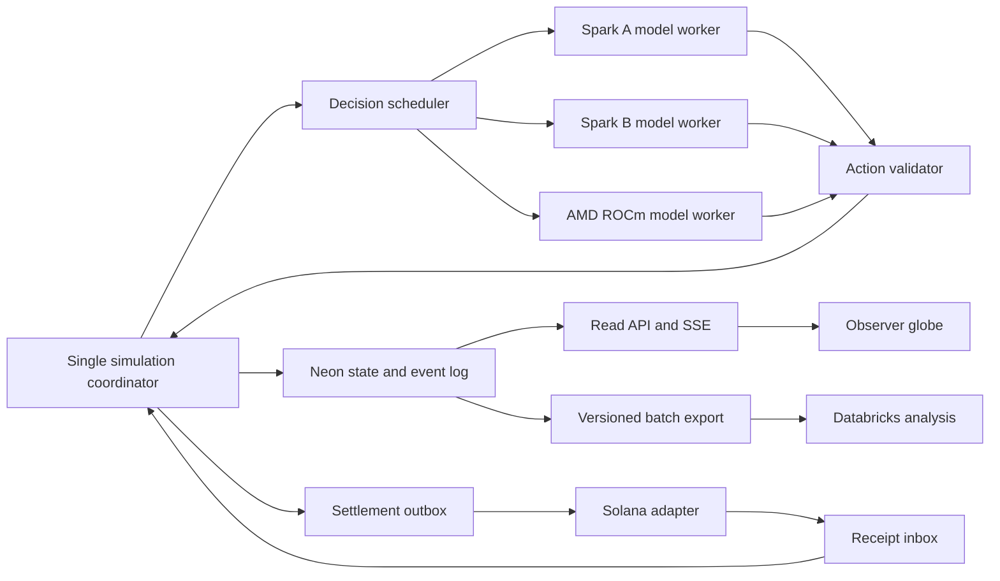

# Faultline — architecture and contracts

## Proposed stack and ownership boundaries

Use ASP.NET Core/C# for Jayden's authoritative engine/API and Ricky's persistence/finance modules, PostgreSQL on Neon for durable state, Python/FastAPI/Pydantic for Ahmad's bounded agent worker and analytics scripts, and React/TypeScript/Vite with a Three.js globe for Kennedy's viewer. This matches the supplied resumes: three teammates have C#/.NET experience, Ahmad has Python/vLLM experience, and Ricky can help Kennedy establish the React shell. These are implementation choices, not packages already installed. Pin working SDK/container versions after smoke tests. A lightweight globe library may wrap Three.js if it passes the first UI integration checkpoint.

Only the coordinator mutates a world's simulation state. Model workers return proposed actions; the Solana adapter returns receipts; the viewer reads projections. One coordinator per run is enforced by a database lease. Do not let four independent services update bank balances directly.

Suggested implementation paths: `backend/Simulation/` and `backend/Api/` for Jayden; `agents/` and `analytics/` for Ahmad; `backend/Storage/`, `backend/Finance/`, and `settlement/` for Ricky; `frontend/` and `ops/` for Kennedy. Shared `contracts/` belongs to Jayden with review by affected owners. Ricky's TypeScript Solana worker handles outbox operations; it never updates world balances directly. These paths are planned; they are not currently implemented.

The Python agent worker accepts bounded coordinator-issued jobs through internal `POST /decide`, returns job IDs immediately, and exposes completed results through `GET /results?after=N`. Jobs contain trusted request metadata, observations, and candidate actions. The coordinator drains results at tick boundaries. The worker performs prompts, inference routing, syntax validation, and telemetry; the C# engine performs role/resource validation and state mutation. Use a shared internal service token and permit only the backend host. No agent worker writes simulation tables.

## Tick lifecycle

1. Load pending external receipts and scheduled scenario events for tick t. Apply idempotently.
2. Apply exogenous disruptions before movement and agent actions. Recompute affected route eligibility. Advance convoys and periodic production, consumption, and loan deadlines.
3. Build each due agent's observation from committed state. Save its observation tick, entity dependency versions, information references, action candidates, and prompt/model versions. Enqueue at most one outstanding request per agent.
4. Drain completed proposals up to the tick cutoff without blocking on all agents. Sort ready proposals by request order, then agent ID for deterministic application given the same recorded proposal sequence.
5. Validate against the latest relevant entity state, apply accepted actions, append explicit effects and accounting entries, and enqueue external settlement work. Rejected actions have a rejection event and no state effect.
6. Commit state changes, monotonically ordered events, and outbox entries in one PostgreSQL transaction. Publish the new projection after commit.

Asynchronous decisions remain eligible for up to five ticks, but any changed dependency requires revalidation or regeneration. A whole-world version change does not invalidate an unrelated citizen purchase. A stale loan approval cannot spend liquidity already used by another action. Failed inference produces a declared `hold` action with `source=rule_fallback`, not a fabricated model decision. Timeout after 15 seconds for the starting benchmark, at most one retry within the request deadline, then circuit-break the unhealthy worker. Values are configurable and benchmarked.

## Model and event contracts

Use [action.schema.json](contracts/action.schema.json) for generated proposals. The coordinator supplies request/run/agent IDs and observation metadata; the model returns only `action_type`, `params`, `reason`, and `evidence_ids`. It must select available IDs. A short stated rationale is a generated explanation, not proof of correctness or private model reasoning.

The generated action schema fixes the vocabulary and action-specific fields. Role authorization, available funds, inventory, treaty validity, counterparty agreement, and route feasibility remain semantic checks in code. The engine attaches trusted identity; it ignores any identity implied inside a reason or message.

| Action group | Allowed actor and semantic guard |
| --- | --- |
| `hold`, `message` | Any agent; recipients must be permitted neighbors/counterparties, with message length/cooldown limits |
| `purchase` | Citizen or business; existing visible offer, matching location, enough available money and stock |
| `publish` | Government or media; an unverified claim remains labeled; any referenced event must be known to the actor |
| `set_border` | Government controlling that edge; future expiration tick; cannot alter another country's edge |
| Agreement actions | Government/business; target and counterparty exist; only the named counterparty can respond |
| `request_loan`, `accept_loan`, `repay` | Business; request/offer must name this borrower; verify amount, term, version, and available cash |
| `respond_loan` | Bank named by the request; policy and available liquidity permit the exact offer |
| `choose_route`, `dispatch` | Business owning the shipment; reserved inventory and confirmed escrow; calculate routes in code |
| `deposit`, `withdraw` | Citizen or business; own cash/deposit claim and eligible bank; bank liquidity limits withdrawal |
| `express_support`, `migrate` | Citizen; current country/destination eligibility, with a real path and modeled travel time |

Reject future observation ticks, unknown evidence IDs, evidence outside the actor's observation, repeated request IDs, and expired proposals. Edge/treaty expirations restore prior permissions only if that same update remains authoritative; they cannot overwrite a newer government decision. Record reason codes such as `ROLE_FORBIDDEN`, `UNKNOWN_ENTITY`, `INSUFFICIENT_FUNDS`, `STALE_DEPENDENCY`, and `EXPIRED_PROPOSAL`.

Use [event.schema.json](contracts/event.schema.json) for event envelopes. Each event has a unique ID, run ID, tick, sequence, event type, source, entity IDs, cause IDs, and payload. Sources are `scenario`, `model`, `rule`, `rule_fallback`, or `external_receipt`. Payloads use a documented event type, not arbitrary frontend interpretations. An accepted action includes `decision_id`, `worker_id`, model revision, request timing, and action payload. Effects link to their actual antecedent event IDs.

Fixtures in [fixtures/](fixtures/) include a model proposal, a border event, a world projection, and a deliberately invalid proposal. They bootstrap independent work and are marked synthetic. The world fixture specifies the projection envelope and collections; implement typed DTOs from it before adding frontend fields. Use additive fields within schema version 1; breaking changes bump the version and update all fixtures.

## Persistent tables

| Table | Key and essential contents |
| --- | --- |
| `runs` | `run_id`; scenario hash, seed, variant, schema/prompt/model versions, mode, status, tick, coordinator lease |
| `agents` | `(run_id, agent_id)`; role, country, location, goals, public/private state, next decision tick |
| `memories` | run/agent plus memory ID; event reference, observation tick, summary, verified/rumor flag |
| `relationships` | run and directed pair; trust, message permission, last interaction |
| `decisions` | request ID unique; observation/dependencies, worker, model, source, timing, outcome, rejection code |
| `events` | event ID unique; `(run_id, seq)` unique, envelope and payload |
| `world_entities` | run/entity ID; versioned countries, locations, edges, businesses, banks, shipments, agreements |
| `ledger_entries` | entry ID; run, accounting transaction, account, signed integer amount, cause event |
| `settlements` | `(run_id, trade_id)` unique; chain accounts, reserved amount, state, tx signatures, receipt watermark |
| `outbox` | operation ID unique; pending external instruction, attempts, signature, acknowledgement state |
| `snapshots` | `(run_id, seq)`; full projection plus state hash and schema version |

Amounts are integer minor units; quantities are integers. PostgreSQL updates and row locks enforce reservations and prevent double spending. Keep a small application connection pool rather than a connection per agent. Snapshot every ten ticks; export events in batches instead of sending every token to Databricks. Persist all actions/effects for replay; compact only prompt memory.

## Read API

All public endpoints are read-only and scope every query by run ID.

| Endpoint | Contract |
| --- | --- |
| `GET /api/runs` | Run metadata, mode, status, actual population and decision coverage |
| `GET /api/runs/{run_id}/snapshot` | Version 1 projection: `run`, `countries`, `locations`, `routes`, `agents_summary`, `shipments`, `banks`, `metrics`, `compute`; includes `seq` and `tick` |
| `GET /api/runs/{run_id}/events?after_seq=N&limit=100` | Ordered event envelopes; limits capped at 500 |
| `GET /api/runs/{run_id}/agents/{agent_id}` | Profile, public observer detail, observed information references, paginated decisions and memories |
| `GET /api/runs/{run_id}/stream?after_seq=N` | SSE event envelopes with event ID `seq`; heartbeat every 15 seconds |
| `GET /api/runs/{run_id}/finance` | Bank cash, deposits, receivables, overdue exposures, linked trade and settlement IDs |
| `GET /api/experiments/{experiment_id}` | Databricks-produced comparison, run counts, failures, metrics, provenance |
| `GET /api/health` | Coordinator freshness, database reachability, inference readiness, settlement backlog, analytics freshness |

The viewer fetches a snapshot at seq S, then events after S. Reconnection resumes from the last sequence; duplicate events are ignored by event ID. The first frontend implementation can refetch projections after effects, later optimizing to deltas. A dropped connection displays “last updated,” not fake moving live state. Observer profiles may show private state for teaching, clearly separated from what other agents can observe.

Operator scripts create runs and choose configured policy variants. Authentication for operator mutations is separate from public read routes. SSH tunnels expose inference to the backend host, not browser clients; model workers never receive database or signing keys.

## Recovery and replay

Pause advancement if the authoritative database is unavailable; retain the last viewer projection and mark it stale. On restart acquire the run lease, restore the latest snapshot/state, reapply committed events as needed, reconcile pending settlements, then resume. External receipts are applied at tick boundaries. Request and operation IDs prevent repeated effects after reconnect.

A recorded replay applies accepted historical effects without generating new decisions or submitting transactions. A new counterfactual is a fresh run with cloned initial state, reset pending decisions, and separate chain accounts. Replaying a live recording is different from rerunning the same seed: model inference and asynchronous arrival order need not reproduce exactly.

## Required integration checks

Verify duplicate/stale proposals, concurrent spending, unknown IDs, forbidden role actions, disconnected routes, repeated receipts, expired agreements, SSE reconnect, and restart with pending settlement. These checks test cross-service behavior; generating valid JSON alone does not prove an action is legal.
