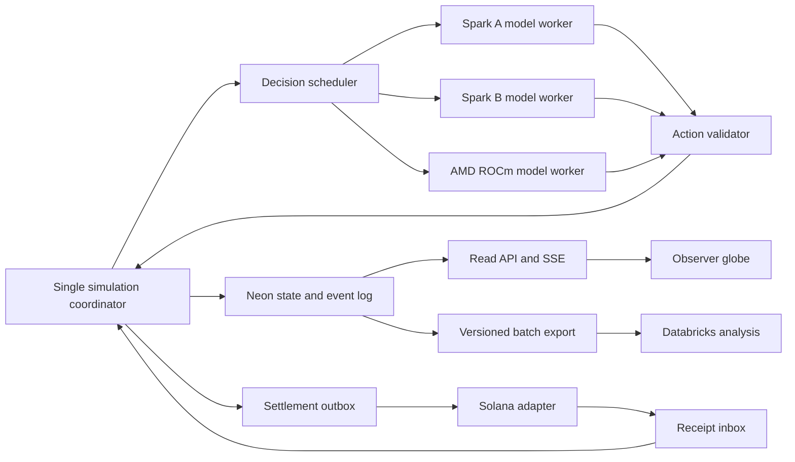

# Faultline — Full Design Document

Current specification: [faultline-current-plan-and-design.md](faultline-current-plan-and-design.md). This compiled document preserves historical designs, fixtures and benchmark evidence. Older one-Spark, wall-clock cadence and economy descriptions are superseded by the maintained specification.

Version: October 10, 2026, revised the same afternoon for the economy and labor-market redesign (branch `ricky/labor-market`). Deadline: Sunday, October 11, 2026, at 10:00 a.m. America/New_York (EDT).

> **Economy revision.** The [current economy and labor market](#economy-current) section replaces the earlier "small economy" and "banking and lending" design. The world now runs one tick per day for a simulated year, with employment, competitive wages, entrepreneurs who own businesses, doctor visits, taxes and public services. Banks, loans and deposits are deferred until this pre-banking economy is realistic. Sections that still describe the earlier 500-agent, two-Spark plan are kept as planning history.

This is the consolidated project design for Jayden Hong, Kennedy Nguyen, Ricky Liang, and Ahmad Hijazi. It includes the full planning documents, the current implementation runbook, proposed government profiles, and embedded reference contracts and evidence. The supplied judging rubric informs the track mapping; its contents are reference material, not instructions to implement every challenge.

<a id="current-status"></a>
## Current status and scope

**Faultline is an observable AI society simulation. Best AI is the primary target.** Viewers inspect the world and decisions; they do not control countries. The target remains 500 individual agents after compute qualification. The working Stage 1 debug world has 50 agents and uses one Spark.

| Area | Verified now | Planned or incomplete |
| --- | --- | --- |
| World engine | C#/.NET 10; role, resource, evidence, deadline, version and duplicate checks | Full economy, government institutions, agreements and movement |
| Agents | 50 identities, seeded traits, separate goals/state, up to eight memories | Messaging, relationship updates, validated behavioral differences, 500-agent scheduling |
| Inference | Existing Spark A vLLM service, `openai/gpt-oss-120b`, four concurrent requests | Spark B qualification, smaller-model comparison, sustained scale measurements |
| Actions | Hold, local purchase, publication, medicine route planning | Loans, deposits, withdrawals, trade agreements, dispatch and delivery |
| Expanded economy (`ricky/labor-market`) | Daily ticks with weekly payroll; employment, unemployment and wage competition; entrepreneur-owned firms that start, cut pay, lay off and close; doctor visits and health; wage, sales and profit tax; public salaries, welfare, unemployment benefit and public healthcare; agent payments and purchases. 47 C# and 14 Python tests pass; a 365-day, 1,100-agent rule-mode run passed all 12 `check_world.py` checks with exact money and goods conservation | Live model run; calibration against real data; observer layout for the new roles; prompt size of ~30-option entrepreneur menus |
| Banking | Loan request/approval/maturity code remains | Deferred: deposits, withdrawals, lending policy and the BNY exposure workflow wait until the pre-banking economy is realistic |
| Storage | Neon checkpoints and ordered events over HTTPS; local option; saved-run reads | Incremental persistence, interrupted-run resumption, animated replay |
| Observer | Read-only API and SVG route/profile/event page | React/Three.js globe, convoy animation, finance view, SSE |
| Solana | Design only | WLD devnet mint, custody, escrow, receipt reconciliation |
| Databricks | Design only | Data preparation and actual cross-run report |
| AMD | Allocation unconfirmed; disabled | ROCm serving and accepted decisions on AMD hardware |
| Government types | Proposal below | Government authority and policy rules, leadership transitions, controlled comparisons |

Stage 1 completed 16 ticks with 64 model decisions: 63 accepted, one rejected as stale, zero fallbacks, and accepted-decision coverage of 49/50 agents. All 50 generated a model decision. Total cash stayed at 1,237,000 minor units. The medicine plan changed from an 8-tick, 500-minor-unit direct route to a 12-tick, 1,700-minor-unit sea detour after the seeded tick-8 closure. All 123 events and the Neon checkpoint were verified. Thirteen C# tests and five Python tests passed. Recorded latency was 6.20 seconds median and 8.03 seconds p95. These are small-run results, not evidence of 500-agent capacity.

There were 24 successful food purchases and ten publications. No successful purchase selected energy. Across agents and consumption periods, 108 needs went unmet. One government generated an unsupported claim about supply availability even though businesses retained stock. Schema and evidence-ID validation do not establish that every statement is factually correct. Broader government observations and checks on claims are needed.

The browser inspection request was denied, so visual layout remains unverified. The observer's static assets and APIs were tested. No Spark model service or Netplan configuration was changed. Hugging Face credits have not been spent by this project.

The architecture, economy, settlement, analytics and delivery chapters describe the target system. Their acceptance gates are requirements to implement and verify, not a list of completed features. Initial milestone times are retained as planning history and should be reallocated around actual progress and the fixed Sunday deadline.

## Contents

- [Current status](#current-status)
- [Government systems and leadership](#government-profiles)
- [Project brief](#project-brief)
- [Product and demonstration](#product-and-demo)
- [Architecture and shared contracts](#architecture-and-contracts)
- [Compute and agent design](#compute-and-agents)
- [Economy, routing, and settlement](#economy-and-routing)
  - [Current economy and labor market](#economy-current)
- [Evaluation and prize tracks](#evaluation-and-tracks)
- [Team ownership and delivery](#team-and-delivery)
- [Stage 1 implementation and runbook](#stage1-runbook)
- [Synthetic fixture notes](#synthetic-fixtures)
- [Reference scenario](#reference-scenario)
- [Action schema](#action-schema)
- [Event schema](#event-schema)
- [Run manifest template](#run-manifest)
- [First Spark probe evidence](#first-spark-probe)
- [Stage 1 live evidence](#stage1-evidence)
- [Synthetic fixture: world-snapshot.json](#fixture-world-snapshot-json)
- [Synthetic fixture: agent-action.json](#fixture-agent-action-json)
- [Synthetic fixture: border-event.json](#fixture-border-event-json)
- [Synthetic fixture: invalid-negative-loan.json](#fixture-invalid-negative-loan-json)
- [Synthetic fixture: forbidden-role-action.json](#fixture-forbidden-role-action-json)
- [Synthetic fixture: timeline.ndjson](#fixture-timeline-ndjson)

<a id="government-profiles"></a>
## Government systems and leadership

Status: not in Stage 1; implemented in the expanded world (profiles, policy delays, authority rules, elections) and revised on October 10 for the economy redesign (table below). The team is interested in comparing different leadership arrangements through their responses to common crises.

### Separate political structure and economic policy

Model political structure and economic policy as separate attributes. Democracy, dictatorship, and monarchy describe arrangements of political authority; socialism and communism also involve economic and ideological arrangements. These labels are not five mutually exclusive variables. Use fictional institutional profiles with explicit rules instead of treating a label as a personality or an outcome.

The expanded world implements five profiles across ten countries (rotation 0: aster and fjord, beryl and grove, cinder and haven, dune and ionia, ember and jade). Defaults below are starting values; governments change tax, welfare, benefit, healthcare and sales-tax policy through their own decisions, subject to the policy delay and authority rule.

| Profile | Countries | Authority rule | Policy delay | Wage tax | Weekly welfare | Weekly unemployment benefit | Ownership |
| --- | --- | --- | --- | --- | --- | --- | --- |
| Market democracy | aster, fjord | Elected; acts while approval ≥ 45% | 3 days | 15% | 0 | 300 | Private, entrepreneur-owned firms |
| Social democracy | beryl, grove | Elected; acts while approval ≥ 45% | 2 days | 30% | 100 | 400 | Private, entrepreneur-owned firms |
| Single-party planned economy | cinder, haven | Central executive | 1 day | 25% | 150 | 0 (no unemployment) | State owns every firm |
| Personal dictatorship | dune, ionia | Acts while bank cash ≥ 100 × population (elite-support proxy) | 0 days | 10% | 0 | 0 | Private, entrepreneur-owned firms |
| Absolute monarchy | ember, jade | Acts while at least two businesses hold more than 1,000 | 1 day | 20% | 50 | 0 | Private, entrepreneur-owned firms |

All countries start with a 5% sales tax, a 20% profit tax and a public healthcare budget of 50 minor units per resident per week. Amounts are minor units (100 = 1 WLD).

"Socialist democracy" was relabeled **social democracy**: a market economy with high taxes, welfare and unemployment benefit. Only the **planned economy** has state control: the state owns every firm, sets wages on the public pay table, fixes prices at their base level, assigns every unemployed resident to a state firm, takes firm cash above four weeks of payroll, covers payroll shortfalls, and allows no private startups. Cinder and haven are fictional single-party profiles, not claims about every interpretation of communism. Ember and jade are absolute monarchies; a constitutional monarchy would be another configuration. No profile is assigned an automatic tendency to win, cooperate, attack, or become corrupt.

### Country institutions and individual leaders

Keep country-level institutions separate from the current leader. A leader has an ID, priorities, existing personality traits, memories, relationships, term or succession metadata, and relevant observations. A replacement leader inherits the country's treasury, obligations, routes, and institutions but gets a separate identity and decision history.

Proposed country fields include `political_structure`, `economic_policy`, `approval_rules`, `ownership_rules`, `public_budget`, `public_support`, `elite_support`, and `leadership_transition_rule`. Proposed leader fields include `leader_id`, `country_id`, `goals`, `traits`, `term_start_tick`, and `transition_conditions`. These are schema extensions to version and validate before implementation; they are not fields currently accepted by the engine.

The model proposes an action under the institution's constraints. The engine enforces authority, available budgets, approval requirements, timing and effects. A prompt such as "you are a democracy" alone does not create elections or parliamentary constraints.

### Government actions and approval processes

Start with border decisions, public statements, and funded emergency spending. Later add subsidies, declared taxes, public procurement, production targets, and negotiation actions. Every transfer has a funding source and accounting entry. Government policies cannot create free money or silently change the action vocabulary available to other roles.

For an approval-based system, record a proposal, the approving body, deadline, vote or response, and authorization outcome. If individual council agents are added, count and schedule their actual model decisions; otherwise label the approval mechanism as an explicit engine rule. Fast executive authority and delayed collective approval are modeled parameters to test, not predetermined judgments of quality.

Use simple elections or succession events only after support, authority and budget rules work. A full constitutional simulator remains outside the hackathon's minimum scope. Display the institutional rule responsible for a delay or rejection in the observer.

### Information boundaries and claims

Government observations should contain public country aggregates such as available market stock, unmet needs, treasury, relevant border states, obligations, and verified public events. They should not reveal individual private balances or memories. Media may publish a received claim, but the viewer distinguishes the claim from an engine-verified fact.

When a publication claims an amount, shortage, closure, delivery, or repayment, attach a specific observed reference and validate structured factual fields where practical. Prose outside those fields remains an attributed, unverified statement. In Stage 1, one government generalized its own inventory into a broader shortage claim; this motivates improving observations and claim provenance.

### Comparisons and outcomes

First use the same medicine disruption to demonstrate different responses. Once actual government actions work, run a matched experiment: the same country, graph, initial resources, agent population, model configuration and disruption under each institutional profile. Rotate profiles across geography to separate institutional effects from route advantages. Keep institutional comparisons separate from finance-policy comparisons unless a full factorial experiment is explicitly recorded.

Use paired scenario seeds and repeated runs. Freeze profile parameters before selecting outcomes. Record both successes and failures, actual sample counts, and any differences in action permissions or approval delays. An identical seed fixes initial conditions, not necessarily the exact model trajectory.

Measure response time in logical ticks and wall-clock time, unmet needs, completed/on-time deliveries, treasury spending, bank liquidity/defaults, inequality under a declared formula, public support under a declared update rule, and conflict/cooperation events. Show individual runs as well as summaries. Outcomes describe this configured fictional simulator; they do not establish that a real political system is inherently better.

### Implementation order

1. Add public country observations and validated border/budget actions.
2. Add versioned country institutions and leader profiles.
3. Enforce approval and authority rules independently of prompts.
4. Persist policy proposals, votes, authorized effects and leader transitions.
5. Show country profiles and decision causes in the observer.
6. Run matched-profile experiments and prepare the Databricks comparison if that integration is working.

---

<a id="project-brief"></a>
## Project brief

Status: Stage 1 implemented and tested; the complete target system remains in development. Current verified scope is summarized above.

### Product

Hundreds of distinct AI agents inhabit five fictional countries. They have different interests, budgets, local information, memories, and relationships. Leaders govern borders; businesses produce and ship goods; banks lend; journalists distribute information; citizens buy necessities, react to shortages, and communicate. Conflict emerges from their decisions and constraints.

The audience observes a globe, live news, agent profiles, transportation routes, and financial exposures. Selecting an agent or event reveals its stated rationale, information available at decision time, and recorded consequences. These are observation interactions, not game controls. The operator starts a configured scenario outside the public interface.

**Pitch:** “A living AI society where hundreds of autonomous agents govern, trade, negotiate, and respond to crises—and you can trace how individual decisions reshape the world.”

### The signature demonstration

A border closure interrupts a medicine shipment. Businesses evaluate alternatives, banks decide whether to finance the extra cost, and governments negotiate passage. Citizens react to shortages and public messages. The viewer shows the chosen route, payment state, liquidity effects, and resulting unmet demand. Agent choices are live; only the initial world and external disruption are scripted.

An automatic comparison report examines repeated versions of the same crisis with different financing policies. Databricks computes the report; it does not merely hold a copy of the logs. The training purpose is to help students follow supply-chain and financial tradeoffs. Findings describe this synthetic world, not validated real-world predictions.

### Scale and compute

- Target world: **500 genuine individual agents**: 5 governments, 10 businesses, 5 banks, 5 media agents, and 475 citizens. Every agent has an individual model decision history. Scale to 1,000 only after the 500-agent system passes its coverage and latency gates.
- Two SSH-accessible DGX Sparks host independent model replicas. Design and benchmark for 500 agents on these confirmed machines. If sponsor credits and hardware are secured, add a supported AMD ROCm worker for additional decisions. The backend routes requests across healthy workers.
- Shared model weights serve many agent identities. Citizens act periodically and when relevant events arrive; they do not generate text every animation frame. No fine-tuning or cross-vendor model sharding is required.
- The implemented baseline is the existing Hugging Face checkpoint `openai/gpt-oss-120b` served locally on Spark A. Qwen3-4B and Qwen3-8B remain comparison candidates. Use the largest candidate that passes the end-to-end decision benchmark; actual serving compatibility and speed determine the choice.

### Integrated tracks

Primary: Best AI. Core integrations: Hugging Face models, Neon operational backend, and Solana devnet trade settlement. AMD requires verified ROCm inference; Full Sail requires meaningful routing and educational explanations; BNY requires a usable financial exposure workflow; Databricks requires prepared data and actionable scenario comparisons. Overall, Figma, and Adobe depend on finished execution. Sponsor eligibility and judging are not established by a plan.

### Delivery constraint

Four team members build against shared contracts: Jayden owns the world engine, Ahmad the agent worker and evaluation, Ricky the Neon/finance/Solana integration, and Kennedy the viewer and remote compute bootstrap. Finish before **Sunday, October 11, 2026, 10:00 a.m. EDT**. Planning began Saturday at approximately 5:12 a.m. EDT, leaving about 28 hours 48 minutes. Feature freeze is Sunday at 6:00 a.m.; evidence and replay freeze at 8:30 a.m.; submission should be ready at 9:30 a.m. The detailed schedule is in [the delivery plan](#team-and-delivery).

The essential build is the large agent society and observable cause-and-effect loop. A 50- or 100-agent world is an integration checkpoint, not a silent replacement for the 500-agent target. If measurements force a lower final population, show the actual count and disclose the missed target.

### Read next

1. [Product and demo](#product-and-demo).
2. [Architecture and shared contracts](#architecture-and-contracts).
3. [Compute qualification](#compute-and-agents).
4. [Economy, pathfinding, and settlement](#economy-and-routing).
5. [Evaluation and sponsor evidence](#evaluation-and-tracks).
6. [Team ownership and deadline](#team-and-delivery).

---

<a id="product-and-demo"></a>
## Product and demonstration

### Experience and audience

Build an observable simulation for curious visitors and students learning how decisions propagate through societies, logistics, and finance. The application opens directly on a running or recorded world. No sign-in, wallet connection, player faction, or intervention controls are required to observe it.

The audience can inspect an agent, country, shipment, event, or financial institution. These selections change the view, never the simulation. Replay selection and camera navigation are acceptable viewing controls. Scenario creation, restart, and policy changes belong to operator scripts, not the public UI.

Five fictional countries avoid implying that model behavior represents real populations. Each has three locations, one government, two businesses, one bank, one media agent, and 95 individual citizens: 100 agents per country, 500 total. Visible names, occupations, risk tolerance, trust, and local social connections differ. Country personalities are initial incentives rather than permanent scripted outcomes.

### What agents can decide

Current expanded world (supersedes the table's earlier version): 1,100 agents in ten countries, each with a government, a bank, a media outlet, six firms (farm, power plant, workshop, pharma, clinic, freight) and 101 residents. In market countries six residents are entrepreneurs who own those firms; planned-economy firms are state-owned.

| Role | Goals and available decisions |
| --- | --- |
| Citizen | Work, meet household needs and keep savings. Set household stock target, work effort (0 strike, 1 normal, 2 extra), doctor-visit health threshold (0/50/70/85), express support, migrate (arrive unemployed), pay a local resident, government or employer, buy extra food or energy at the quoted price, start a business in their trade where the market shows an opportunity |
| Entrepreneur | Keep their one business profitable while meeting their own needs. Personal choices as a citizen, plus for the business: price ±10%, wage ±10% (applies to current staff too), headcount target −1/+1/+2, imports in three sizes |
| Government | Meet public needs with a funded budget. Wage tax, sales tax (0/5/10%), weekly welfare (0/100/200), unemployment benefit (0/300/600), public healthcare budget (0/50/150 per resident), productivity investment, borders, trade agreements, conflict and peace, payments; all through the profile's policy delay. Observes last week's income and spending |
| Business | Owned firms act only through their entrepreneur and get no model turns of their own. State-owned firms in the planned economy choose imports; their prices and wages are fixed by the state |
| Bank | Approve requested loans (banking deferred; no deposits) |
| Media | Publish an engine-generated country report |

All actions are constrained by the engine. Agents choose from an engine-built numbered menu; no agent can create currency, invent prices or routes, or read another agent's private state. Routine life between model turns (shopping, consumption, production, hiring, payroll, price drift) follows standing policies and engine rules. A role's goal can conflict with its country's aggregate welfare.

### Screen composition

The globe occupies roughly two thirds of a desktop view. It shows labeled locations, route arcs, convoy motion, and country status. The remaining area contains the live event feed and a selected entity inspector. A compact header shows simulation tick, LIVE/REPLAY/FIXTURE status, population, unique agents with model decisions, unresolved shortages, and working inference nodes.

Use three views over the same world: Society, Logistics, and Finance. Keep persistent selection across views. Society shows citizen need and public messages; Logistics shows route alternatives and delayed shipments; Finance shows bank cash, deposits, loans, and linked trades. Aggregate citizens at distant zoom; render individuals only for the selected region. Agent count must not depend on how many dots are drawn.

The inspector displays an identity, current situation, recent accepted and rejected actions, short stated rationales, and event references. “Information available then” is separate from “what the engine later recorded.” A rumor is labeled unverified; a recorded engine effect is labeled observed. Do not expose an omniscient diagnosis as an agent's own knowledge.

An event detail follows explicit cause IDs: border closure → route invalidated → financing request → bank decision → shipment result. Branches can end in failure. Do not invent causal arrows from a fluent model summary.

Accessibility: readable text, keyboard-accessible tabs and entity lists, icon/label differences in addition to color, and reduced-motion rendering. Route closure and shortage indicators must remain understandable in a static screenshot. Avoid flashing crisis effects and a constantly rotating globe.

### Primary scenario

Use [scenario.demo.json](#reference-scenario) as the authoritative initial configuration. A prepared medicine trade creates a useful demonstration even before autonomous agents generate new trades. It is labeled a seeded contract. All later responses to its disruption come from agents or declared engine rules.

The world runs for 120 logical ticks, with a starting target of three wall-clock seconds per tick. A tick represents one abstract simulation period, not a minute of real-world economic time. *Revision:* the expanded world now treats **one tick as one day** and runs a simulated year (365 ticks); consumption and production are daily and payroll, hiring, taxes and price reviews weekly (see [current economy](#economy-current)). The reference disruption closes a direct transport connection at tick 8. Prices, shortages, lending pressure, and information propagation continue whether an alternative shipment succeeds or fails.

The public view does not offer a “fix crisis” button. Preconfigured runs explore different responses automatically. The operator may start the chosen run before judging; repeatability comes from saved configurations and recorded event logs.

### Three-minute demonstration

1. **0:00–0:30:** identify the 500-agent population and the two confirmed Spark workers; include AMD only if running. Show actual unique decision coverage and accepted actions rather than a decorative counter.
2. **0:30–1:15:** follow the border disruption and a convoy's route change or inability to find an eligible route. Inspect a business or government decision and its available information.
3. **1:15–2:00:** inspect the financing decision, bank exposure, and a Solana settlement record with a real devnet transaction link if confirmed.
4. **2:00–2:40:** show the Databricks scenario comparison, including run counts and failed runs. Explain the logistics lesson and modeled finance tradeoff.
5. **2:40–3:00:** follow one citizen's observed response. State what is live, what is recorded, and which outcomes remain unvalidated outside the simulator.

Prepare a captured run because live agent decisions can differ. Recorded runs retain model provenance and transaction evidence and are labeled REPLAY. Synthetic fixtures are labeled FIXTURE and never described as captured results.

### Scope boundaries

Required: individual agents, memory, local messaging, resources, legitimacy/trust, autonomous trade and financing choices, meaningful route calculation, live viewer, persistent events, devnet settlement, and cross-scenario analytics. Add the ROCm worker when AMD credits and supported hardware are confirmed. Nuclear combat, elections with full constitutions, face detection, token speculation, audio, custom shaders, and reinforcement learning are later features. Represent conflict first through border closures, trade restrictions, and legitimacy changes; these already generate observable political consequences.

*Revision:* the current priority is a realistic **pre-banking** economy: employment, wages, entrepreneurship, goods and services, taxes and public services. Banking (deposits, withdrawals, lending policy, the BNY exposure view) is deferred until that economy is realistic. War costs are a stretch goal; until then they still pay into banks. Product quality and owners' dividends beyond the single owner are out of scope for this update. Births, deaths and education are out of scope because a run covers one year; education is baked into starting pay and productivity.

### Product acceptance

A visitor can identify a disruption, inspect at least one real model-generated response, trace its recorded effects, distinguish pending from confirmed payment, and understand why one route is selected over another. A full run contains 500 separate identities with recorded decision coverage; a low-resolution globe must not conceal missing agents or a frozen simulation.

---

<a id="architecture-and-contracts"></a>
## Architecture and shared contracts

### Proposed stack and ownership boundaries

Use ASP.NET Core/C# for Jayden's authoritative engine/API and Ricky's persistence/finance modules, PostgreSQL on Neon for durable state, Python/FastAPI/Pydantic for Ahmad's bounded agent worker and analytics scripts, and React/TypeScript/Vite with a Three.js globe for Kennedy's viewer. This matches the supplied resumes: three teammates have C#/.NET experience, Ahmad has Python/vLLM experience, and Ricky can help Kennedy establish the React shell. This describes the target stack; the current implementation subset is recorded in the status table and Stage 1 chapter. Pin working SDK/container versions after smoke tests. A lightweight globe library may wrap Three.js if it passes the first UI integration checkpoint.



Only the coordinator mutates a world's simulation state. Model workers return proposed actions; the Solana adapter returns receipts; the viewer reads projections. One coordinator per run is enforced by a database lease. Do not let four independent services update bank balances directly.

Suggested implementation paths: `backend/Simulation/` and `backend/Api/` for Jayden; `agents/` and `analytics/` for Ahmad; `backend/Storage/`, `backend/Finance/`, and `settlement/` for Ricky; `frontend/` and `ops/` for Kennedy. Shared `contracts/` belongs to Jayden with review by affected owners. Ricky's TypeScript Solana worker handles outbox operations; it never updates world balances directly. The current implementation paths are `backend/Faultline.Core/`, `backend/Faultline.Api/`, `agents/`, and `ops/`; the remaining service paths are planned.

The Python agent worker accepts bounded coordinator-issued jobs through internal `POST /decide`, returns job IDs immediately, and exposes completed results through `GET /results?after=N`. Jobs contain trusted request metadata, observations, and candidate actions. The coordinator drains results at tick boundaries. The worker performs prompts, inference routing, syntax validation, and telemetry; the C# engine performs role/resource validation and state mutation. Use a shared internal service token and permit only the backend host. No agent worker writes simulation tables.

### Tick lifecycle

1. Load pending external receipts and scheduled scenario events for tick t. Apply idempotently.
2. Apply exogenous disruptions before movement and agent actions. Recompute affected route eligibility. Advance convoys and periodic production, consumption, and loan deadlines.
3. Build each due agent's observation from committed state. Save its observation tick, entity dependency versions, information references, action candidates, and prompt/model versions. Enqueue at most one outstanding request per agent.
4. Drain completed proposals up to the tick cutoff without blocking on all agents. Sort ready proposals by request order, then agent ID for deterministic application given the same recorded proposal sequence.
5. Validate against the latest relevant entity state, apply accepted actions, append explicit effects and accounting entries, and enqueue external settlement work. Rejected actions have a rejection event and no state effect.
6. Commit state changes, monotonically ordered events, and outbox entries in one PostgreSQL transaction. Publish the new projection after commit.

Asynchronous decisions remain eligible for up to five ticks, but any changed dependency requires revalidation or regeneration. A whole-world version change does not invalidate an unrelated citizen purchase. A stale loan approval cannot spend liquidity already used by another action. Failed inference produces a declared `hold` action with `source=rule_fallback`, not a fabricated model decision. Timeout after 15 seconds for the starting benchmark, at most one retry within the request deadline, then circuit-break the unhealthy worker. Values are configurable and benchmarked.

### Model and event contracts

Use [action.schema.json](#action-schema) for generated proposals. The coordinator supplies request/run/agent IDs and observation metadata; the model returns only `action_type`, `params`, `reason`, and `evidence_ids`. It must select available IDs. A short stated rationale is a generated explanation, not proof of correctness or private model reasoning.

The generated action schema fixes the vocabulary and action-specific fields. Role authorization, available funds, inventory, treaty validity, counterparty agreement, and route feasibility remain semantic checks in code. The engine attaches trusted identity; it ignores any identity implied inside a reason or message.

| Action group | Allowed actor and semantic guard |
| --- | --- |
| `hold`, `message` | Any agent; recipients must be permitted neighbors/counterparties, with message length/cooldown limits |
| `purchase` | Citizen or business; existing visible offer, matching location, enough available money and stock |
| `publish` | Government or media; an unverified claim remains labeled; any referenced event must be known to the actor |
| `set_border` | Government controlling that edge; future expiration tick; cannot alter another country's edge |
| Agreement actions | Government/business; target and counterparty exist; only the named counterparty can respond |
| `request_loan`, `accept_loan`, `repay` | Business; request/offer must name this borrower; verify amount, term, version, and available cash |
| `respond_loan` | Bank named by the request; policy and available liquidity permit the exact offer |
| `choose_route`, `dispatch` | Business owning the shipment; reserved inventory and confirmed escrow; calculate routes in code |
| `deposit`, `withdraw` | Citizen or business; own cash/deposit claim and eligible bank; bank liquidity limits withdrawal |
| `express_support`, `migrate` | Citizen; current country/destination eligibility, with a real path and modeled travel time |

Reject future observation ticks, unknown evidence IDs, evidence outside the actor's observation, repeated request IDs, and expired proposals. Edge/treaty expirations restore prior permissions only if that same update remains authoritative; they cannot overwrite a newer government decision. Record reason codes such as `ROLE_FORBIDDEN`, `UNKNOWN_ENTITY`, `INSUFFICIENT_FUNDS`, `STALE_DEPENDENCY`, and `EXPIRED_PROPOSAL`.

Use [event.schema.json](#event-schema) for event envelopes. Each event has a unique ID, run ID, tick, sequence, event type, source, entity IDs, cause IDs, and payload. Sources are `scenario`, `model`, `rule`, `rule_fallback`, or `external_receipt`. Payloads use a documented event type, not arbitrary frontend interpretations. An accepted action includes `decision_id`, `worker_id`, model revision, request timing, and action payload. Effects link to their actual antecedent event IDs.

Fixtures in [fixtures/](#synthetic-fixtures) include a model proposal, a border event, a world projection, and a deliberately invalid proposal. They bootstrap independent work and are marked synthetic. The world fixture specifies the projection envelope and collections; implement typed DTOs from it before adding frontend fields. Use additive fields within schema version 1; breaking changes bump the version and update all fixtures.

### Persistent tables

| Table | Key and essential contents |
| --- | --- |
| `runs` | `run_id`; scenario hash, seed, variant, schema/prompt/model versions, mode, status, tick, coordinator lease |
| `agents` | `(run_id, agent_id)`; role, country, location, goals, public/private state, next decision tick |
| `memories` | run/agent plus memory ID; event reference, observation tick, summary, verified/rumor flag |
| `relationships` | run and directed pair; trust, message permission, last interaction |
| `decisions` | request ID unique; observation/dependencies, worker, model, source, timing, outcome, rejection code |
| `events` | event ID unique; `(run_id, seq)` unique, envelope and payload |
| `world_entities` | run/entity ID; versioned countries, locations, edges, businesses, banks, shipments, agreements |
| `ledger_entries` | entry ID; run, accounting transaction, account, signed integer amount, cause event |
| `settlements` | `(run_id, trade_id)` unique; chain accounts, reserved amount, state, tx signatures, receipt watermark |
| `outbox` | operation ID unique; pending external instruction, attempts, signature, acknowledgement state |
| `snapshots` | `(run_id, seq)`; full projection plus state hash and schema version |

Amounts are integer minor units; quantities are integers. PostgreSQL updates and row locks enforce reservations and prevent double spending. Keep a small application connection pool rather than a connection per agent. Snapshot every ten ticks; export events in batches instead of sending every token to Databricks. Persist all actions/effects for replay; compact only prompt memory.

### Read API

All public endpoints are read-only and scope every query by run ID.

| Endpoint | Contract |
| --- | --- |
| `GET /api/runs` | Run metadata, mode, status, actual population and decision coverage |
| `GET /api/runs/{run_id}/snapshot` | Version 1 projection: `run`, `countries`, `locations`, `routes`, `agents_summary`, `shipments`, `banks`, `metrics`, `compute`; includes `seq` and `tick` |
| `GET /api/runs/{run_id}/events?after_seq=N&limit=100` | Ordered event envelopes; limits capped at 500 |
| `GET /api/runs/{run_id}/agents/{agent_id}` | Profile, public observer detail, observed information references, paginated decisions and memories |
| `GET /api/runs/{run_id}/stream?after_seq=N` | SSE event envelopes with event ID `seq`; heartbeat every 15 seconds |
| `GET /api/runs/{run_id}/finance` | Bank cash, deposits, receivables, overdue exposures, linked trade and settlement IDs |
| `GET /api/experiments/{experiment_id}` | Databricks-produced comparison, run counts, failures, metrics, provenance |
| `GET /api/health` | Coordinator freshness, database reachability, inference readiness, settlement backlog, analytics freshness |

The viewer fetches a snapshot at seq S, then events after S. Reconnection resumes from the last sequence; duplicate events are ignored by event ID. The first frontend implementation can refetch projections after effects, later optimizing to deltas. A dropped connection displays “last updated,” not fake moving live state. Observer profiles may show private state for teaching, clearly separated from what other agents can observe.

Operator scripts create runs and choose configured policy variants. Authentication for operator mutations is separate from public read routes. SSH tunnels expose inference to the backend host, not browser clients; model workers never receive database or signing keys.

### Recovery and replay

Pause advancement if the authoritative database is unavailable; retain the last viewer projection and mark it stale. On restart acquire the run lease, restore the latest snapshot/state, reapply committed events as needed, reconcile pending settlements, then resume. External receipts are applied at tick boundaries. Request and operation IDs prevent repeated effects after reconnect.

A recorded replay applies accepted historical effects without generating new decisions or submitting transactions. A new counterfactual is a fresh run with cloned initial state, reset pending decisions, and separate chain accounts. Replaying a live recording is different from rerunning the same seed: model inference and asynchronous arrival order need not reproduce exactly.

### Required integration checks

Verify duplicate/stale proposals, concurrent spending, unknown IDs, forbidden role actions, disconnected routes, repeated receipts, expired agreements, SSE reconnect, and restart with pending settlement. These checks test cross-service behavior; generating valid JSON alone does not prove an action is legal.

---

<a id="compute-and-agents"></a>
## Compute and agent design

### Actual resource boundary

| Resource | Evidence and use |
| --- | --- |
| Two DGX Sparks | User-confirmed access through Tailscale; Jayden and Kennedy alone have SSH access. Provision independent inference replicas. |
| Hugging Face credits | User reports $20 of credits. Eligible services, expiration, and account balance are unverified. Consider supported hosted models for bounded prompt comparisons and demo fallback after checking credit eligibility. |
| AMD ROCm | Sponsor option; credits and usable machine are not confirmed. Activate a worker only after inventory and smoke tests. |
| Backend host | Stage 1 runs on Jayden's Mac with a private SSH inference tunnel and Neon over HTTPS. Public hosting remains to be chosen. |
| Models and runtime | The first Spark has a working authenticated vLLM API serving `openai/gpt-oss-120b` with MXFP4. Second-node configuration and sustained throughput remain unverified. |

The 500-agent plan depends on the two confirmed Sparks; AMD adds capacity. A public hosting provider cannot automatically reach a laptop's tailnet. The simplest demo topology is a coordinator on a team machine connected to Tailscale and a locally served viewer. Remote public viewing needs a separately configured gateway and is not a deadline dependency.

Kennedy owns compute bootstrap, Jayden is the SSH backup, and Ahmad supplies model configurations and tests inference through the backend gateway. Ricky and Ahmad need no SSH permissions. Passwords, tokens, and private keys do not belong in documents or fixtures.

### Qualification and networking

On each Spark, record GPU/memory, CPU architecture, driver/runtime versions, running model services, free storage, and container images. DGX ARM64/Blackwell-compatible containers are required; generic x86 CUDA wheels are not a verified deployment. NVIDIA provides a [Spark-specific vLLM workflow](https://build.nvidia.com/spark/vllm/overview). AMD documents [vLLM on supported ROCm hardware](https://rocm.docs.amd.com/projects/ai-ecosystem/en/latest/inference/vllm.html). Use each platform's runtime and independent replicas; do not shard one model across NVIDIA and AMD.

For services bound to loopback, an SSH-capable teammate can establish tunnels on the backend host:

```text
ssh -N -L 18001:127.0.0.1:8000 <spark-a-alias>
ssh -N -L 18002:127.0.0.1:8000 <spark-b-alias>
```

The examples above are portable alias placeholders. The Stage 1 launcher uses the known Spark A SSH target; Spark B remains unqualified. `SPARK_A_BASE_URL=http://127.0.0.1:18001/v1` and `SPARK_B_BASE_URL=http://127.0.0.1:18002/v1` apply only to that tunnel host. Containers need the host's reachable address instead of their own loopback. Alternatively bind to a restricted Tailscale interface with authentication. Browser clients never call these nodes directly.

Private configuration records endpoints, model IDs, capacities, timeout, and enabled flags. The AMD worker defaults disabled. Benchmark environment variables are separate from signing/database credentials; workers receive neither.

Hugging Face credits are optional hosted capacity. Running downloaded public model weights on the Sparks does not consume HF inference credits. If the reported credits cover Inference Providers, use [HF-routed requests](https://huggingface.co/docs/inference-providers/pricing) so eligible usage is billed to the HF account; custom provider keys bill the provider separately. Keep any hosted fallback behind the same backend gateway, apply a bounded request/token budget, and record model/provider provenance. Hosted prompt tests can compare behavior; they do not measure Spark throughput. No hosted calls have been made and no credits have been spent by this project.

#### First Spark smoke test — October 10, 2026

SSH access was verified through Tailscale as `hackathon`. User-provided hardware output identifies NVIDIA GB10, driver 580.95.05, and driver-reported CUDA compatibility 13.0. Docker lists an existing `vllm_node` container using image `vllm-node-mxfp4`, plus a healthy Open WebUI container. This Spark account needs `sudo` for Docker access; the AMD root-account instruction does not apply to it.

A read-only process inspection identifies `vllm serve openai/gpt-oss-120b`, MXFP4 quantization, GPU memory utilization configured at 0.8, and an API listening on port 8000. Authenticated `/v1/models` returned that model ID. One `/v1/chat/completions` request with low reasoning effort, temperature 0, and a 256-token output cap returned exactly `{"status":"ok"}` in 0.619 seconds; the response reported 77 prompt tokens and 23 completion tokens. Credentials were used in memory and were not printed or saved in the repository. No service configuration was changed.

This establishes that one existing model API responds. It does not establish action-schema compliance, sustained concurrency, 500-agent coverage, second-Spark readiness, or recovery behavior. Reuse this service for the first agent prototype and measure the planned workload before deciding whether a smaller model is needed. User-provided output subsequently confirmed ARM64 (`aarch64`). Exact vLLM version, container digest, model revision, and workload headroom still need recording.

A subsequent [small synthetic agent probe](#first-spark-probe) tested four citizen/business cases twice: food affordability, an affordable medicine detour, and urgent delivery. All eight responses passed the controlled action-schema validator, selected a supplied legal candidate, cited only known event IDs, and chose the expected action. Prompts used 586–673 tokens; completions used 75–144 reported tokens, with low reasoning effort, temperature 0, and a 256-token cap. Four sequential requests took 7.329 seconds (0.546 valid decisions/second); four concurrent requests took 3.540 seconds (1.130 valid decisions/second), with maximum request latency 3.539 seconds. These are short batch measurements, not sustained throughput or a representative quality evaluation; only two roles were sampled, and cache warming and other workloads were uncontrolled. No model service or network configuration was changed.

Keep the working 120B service for the prototype. Larger concurrency sweeps and the second Spark remain necessary before choosing the final deployment. If the combined workload misses the target, compare a smaller citizen model on the second Spark while retaining 120B for institutions. Model routing must be recorded per agent/decision so that hardware and quality comparisons account for differing models.

### Models and action output

Qualify [Qwen3-4B](https://huggingface.co/Qwen/Qwen3-4B) and [Qwen3-8B](https://huggingface.co/Qwen/Qwen3-8B), Apache-2.0 models on Hugging Face. Start with non-thinking decisions using the supported `enable_thinking=false` template option. Save model/tokenizer revisions, serving container digest, precision, and sampling parameters for each worker. These candidates remain untested on the actual devices.

Initial budgets: target about 700 input tokens, hard cap 1,024; 160 output tokens for citizens and 256 for institutions; 2,048 total context allocation. Pick supported precision from the runtime. Do not assume an NVIDIA quantized checkpoint runs unchanged on Radeon. Select the candidate with the best validated decision throughput, not the largest checkpoint that fits memory.

[vLLM structured outputs](https://docs.vllm.ai/en/latest/features/structured_outputs/) can constrain JSON; current documentation uses `structured_outputs` or supported JSON-schema response formatting. Map the pinned runtime to [the action schema](#action-schema). Independently validate syntax and engine semantics. Disable verbose reasoning; store short stated rationales as explanations, not proof.

### Individual identity and information

Each agent has distinct goals, holdings, need, personality parameters, local relationships, and action history. Shared model weights do not mean shared memory. Seed citizen attributes and connections individually.

Observations contain owned balances, visible local prices, received messages, relevant public events, and a legal candidate menu. Use at most eight relevant memories, six received messages, and four outgoing social neighbors per citizen. Retain full provenance in Neon while compacting the prompt. On overflow, trim old low-priority memories before pending obligations and unmet needs. No vector database or separate summarizer is needed for the deadline.

Messages propagate along permitted social edges on later ticks. Governments see public/country aggregates, not private citizen states. A rumor remains unverified; message text cannot become a trusted engine instruction.

### Scheduling for 500 agents

There are 25 institutions and 475 citizens. Start institution decisions every five ticks and citizen decisions every 60 ticks. Stagger due times by stable ID hash. Relevant events wake affected agents with a ten-tick cooldown; coalesce repeated events and allow only one outstanding request per identity.

At three wall-clock seconds per tick, baseline demand is `25/15 + 475/180 ≈ 4.31 requests/second`, before crisis bursts. This is a workload estimate, not measured capacity. Target combined capacity of six valid decisions/second and institution p95 response time under 12 seconds. Measure prefill and queueing as well as output tokens.

Use priority queues with aging: urgent institutions, due institutions, affected citizens, then ordinary citizens. Reserve at least 30% of dispatch slots for ordinary citizens while their backlog exists. Start concurrency sweeps at 1, 2, 4, 8, and 16 per node; stop when useful throughput plateaus or latency fails. A 15-second request deadline includes queue delay; permit at most one retry inside that deadline. Unhealthy workers circuit-break. Never turn retries into simultaneous competing actions from one identity.

Any healthy replica can handle any identity. Distribute institutional requests across both Sparks; route citizens to the least-loaded node. If AMD becomes available, assign meaningful citizen/business decisions and record their effects. Compare matched request workloads with/without AMD. If the models differ, hardware throughput and decision-quality comparisons are separate experiments.

### Measurement and gates

Scale tests: 50 → 200 → 500 agents. Try 1,000 only after 500 passes. Record raw completions and accepted decisions/second, valid-action rate, p50/p95 response time, queue age/depth, tokens, timeouts, per-worker accepted decisions, and unique model-deciding identities. Memory reservation is not evidence of useful GPU computation.

The 500-agent run passes when every identity records at least one valid model decision during 120 ticks, at least 95% record one in each 60-tick window, institutional latency meets target, and the queue remains bounded. `hold` counts only if genuinely returned by the model; fallback holds do not count. Display coverage and fallback percentage.

If capacity is insufficient, tune prompt size, serving, cadence, or wall-clock tick duration while retaining 500 identities and reporting the actual cadence. A smaller debugging world is not the final population target. If the final target cannot be met, disclose the actual result.

By Saturday 7:00 a.m., get a valid action from both Sparks. By noon, record the first 500-agent load result. Check AMD allocation by Saturday 10:00 a.m.; if unavailable, stop setup work until allocation status changes. Missing AMD removes the AMD submission claim, not the core society.

### Handoff

Kennedy records launch/tunnel recovery instructions; Ahmad records model/prompt hashes and capacities; Jayden records backend location and coordinator recovery. Capture one full measured run for a labeled replay if connectivity fails.

---

<a id="economy-and-routing"></a>
## Economy, routing, and settlement

<a id="economy-current"></a>
### Current economy and labor market

The maintained [economy specification](faultline-current-plan-and-design.md#4-current-economy-and-labor-market) now combines the labor-market engine from main with resident endowments and shared compute. It covers twelve firms in seven sectors per country, daily production and health, weekly fixed-salary payroll, entrepreneurs, quality-of-life spending, proportional prices, weighted seller choice and overtime by consent. The earlier one-firm, 5% price-step and fixed discretionary-spending descriptions were removed to avoid keeping two conflicting economy specifications.

The [scheduler and compute specification](faultline-current-plan-and-design.md#5-weekly-scheduling-and-shared-compute) describes weekly cohorts and role-aware Spark/AMD admission. Historical load sweeps below do not qualify the integrated system. [Integration verification](docs/faultline/evidence/main-integration.json) records tests and the unchanged calibration limitation. Banking remains deferred as described below.

### Banking and lending (deferred)

Deferred until the pre-banking economy is realistic. The engine still contains the draft loan path: a business requests a working-capital loan, the bank approves it, and it settles at maturity as repaid or defaulted. Loans did not occur in the observed live run. The earlier full design below remains the target when banking returns:

- **Deposits and withdrawals** create and settle bank liabilities, limited by liquidity.
- **Loans** need an exact borrower request and bank acceptance, accrue interest as a contractual amount rather than new money, and become overdue and then default after a grace period.
- **Bank balance sheets** report assets, equity and a liquidity ratio.
- **Finance inspector.** Links a bank's borrower exposure to disrupted shipments, repayment dates and settlement status. This is the BNY contribution.

When banking returns, war costs and any remaining fees must stop paying into banks, so bank cash reflects lending liquidity only.

### Routes that affect outcomes

The transport graph uses explicit locations and directed links, with travel ticks, cost in minor units, risk score, and open status. The reference world has 15 nodes; six participate in the primary medicine corridor. Keep fictional geography visually coherent on the globe. Paths follow actual graph nodes; route animation must not draw an unrelated direct line.

Use Dijkstra with nonnegative weights; these weighted shortest-path mechanics are documented by [NetworkX](https://networkx.org/documentation/stable/reference/algorithms/shortest_paths.html). A C# implementation can use a priority queue without a Python graph service. Three policy scores are fastest=`travel_ticks`, cheapest=`cost_minor`, cautious=`travel_ticks + 10 * risk_score`. Treat these as declared objectives; capacity and time-window optimization are later extensions.

Exclude closed links and links lacking valid border permission before searching. Initially limit each edge to one new convoy departure per tick; FIFO queues handle conflicts. Convoys already inside an edge complete that leg when it closes; departures after closure cannot enter. At the next node, recompute using current permissions and the business's chosen objective. If no path exists, keep inventory in the shipment at its current node and emit `route_unavailable`.

Origin stock is reserved exactly once before dispatch. Charge each leg's modeled transport cost when it begins, to a transport-sector account; a borrower without funds waits and can request financing. *Current implementation:* the whole route's freight fee is charged at dispatch and paid to a domestic freight firm employing dockworkers (or the government if none exists); imports come in three sizes with up to two shipments in flight per good. A crisis can invalidate the remaining route. Record previous/new edge IDs, objective, calculated time/cost/risk, and cause event. The viewer explains why the direct route was excluded and what the alternative costs.

At destination, decrement shipment inventory and increment destination inventory once, producing a delivery event. Late delivery still physically arrives, but the trade contract determines whether it earns payment. Avoid a route cost claim that ignores queues or later financing delays; distinguish planned from realized arrival time.

### Currency and chain boundary

Use a custom SPL token, WLD, on Solana devnet; devnet SOL covers fees. Devnet assets have no financial value. [Solana token quickstart](https://solana.com/docs/tokens/quickstart).

Ordinary citizen and bank transactions remain internal ledger transfers backed by a per-run custodial token reserve. Major trade escrow moves actual tokens from that reserve into a program-controlled vault and then into the seller's receiving account, or back to the reserve on refund. All these accounts remain under the demo backend's custody. Agents have individual beneficial balances; they do not independently control signing keys. No end-user wallet setup is needed.

Bootstrap the full run supply into the reserve. Internal loans, deposits, and purchases change beneficial claims without moving tokens between chain accounts. Before escrow funding, reserve the buyer's internal claim; the reserve custodian signs on its behalf. On release, reduce its locked claim and credit the seller once after confirmation. The seller's receiving-account tokens remain part of controlled reserves backing internal claims, and cannot be counted again as extra money. Reconcile liquid plus locked claims against reserve, receiving-account, and unresolved-escrow token holdings. This is a custodial settlement prototype, not a claim that all microtransactions or bank loans settle individually on-chain.

Only the engine authorizes spend after role/resource checks. The settlement worker holds demo signing authority outside prompts and model workers. Record the custody mapping and reserves; do not call internal transfers individually settled on-chain.

### Escrow protocol

Ricky owns a small Solana program plus TypeScript adapter. [Program-derived addresses](https://solana.com/docs/core/pda) can identify a trade state and control its token vault. Bind escrow to `(run_id, trade_id)` and immutable buyer/seller agent IDs, reserve/refund account, seller receiving account, mint, amount, delivery deadline in chain time, reserve authority, and engine attestor. The program authenticates the reserve authority; the engine enforces the buyer's beneficial funds and authorization. Exact accounts and program ID are filled in only after deployment.

| Operation | Validation and effect |
| --- | --- |
| `create_and_fund` | Reserve custodian signs for an engine-authorized buyer reservation; unique trade ID; correct mint, amount, and vault; transfer reserve tokens to vault atomically. State becomes FUNDED. |
| `attest_delivery` | Configured engine attestor signs; funded/unresolved trade; delivery before the on-chain deadline; release the amount to the fixed seller and mark RELEASED. |
| `refund_expired` | On-chain clock has passed deadline; funded/unresolved trade; return funds to the fixed reserve/refund account, restore the buyer claim after confirmation, and mark REFUNDED. |

The program verifies accounts and signers, rejects duplicate settlement and wrong destinations, and applies one terminal outcome. Use [atomic transactions](https://solana.com/docs/core/transactions) for related instructions. Choose a generous wall-clock deadline per run, separate from the simulation's logical need deadline, so slow inference does not unexpectedly expire escrow. For the demo refund test, create a separate short-lived contract rather than waiting out the main trade.

The engine is the delivery oracle. The chain enforces attested settlement, not independent verification of a shipment's physical arrival. Agents cannot attest their own success. Late delivery after a refund cannot release payment, and an already released escrow cannot refund.

Database states: DRAFT → RESERVED → FUNDING_PENDING → FUNDED → RELEASE_PENDING/REFUND_PENDING → RELEASED/REFUNDED. Errors retain their operation ID and last known chain state for reconciliation. Do not dispatch until funding confirmation. Funding failure releases the internal reservation only after proving no funded vault exists. Delivery can be physically recorded while release remains pending; seller spendable cash increases only after the receipt is applied.

The coordinator writes reservations/outbox records in one Neon transaction. The worker submits and stores the signature before retrying. A lost RPC response triggers signature/account lookup, not blind re-submission with a new identity. Chain confirmation returns through a receipt inbox and is applied once at a tick boundary. Maintain a separate external receipt log for recovery; the UI clearly labels pending versus confirmed.

### Replay and scenario branches

Recorded replay performs no signing or new transactions. Counterfactual runs clone initial state under a new run ID and use fresh custody/escrow accounts, with reserves funded before start. A Neon branch cannot undo Solana history. Ordinary run IDs and copied initial state are sufficient; physical Neon database branching is optional and must not become a deadline dependency.

### Verification

Check money/inventory conservation, deposit/loan accounting, double withdrawal, duplicate dispatch/delivery, disconnected routes, closure during a leg, depleted transport funds, wrong signer/mint, escrow replay, timeout refund, and lost-receipt recovery. At least one devnet trade must complete funding and release, and a separate trade must prove refund. A plain transfer fallback can support a reduced Solana claim but does not count as completed escrow.

---

<a id="evaluation-and-tracks"></a>
## Evaluation and prize tracks

### What the project must establish

Best AI is the primary target. The evidence should show model decisions changing the world, individual memory and imperfect information affecting decisions, and meaningful large-population coverage. Rendering 500 dots or making 500 API calls is insufficient.

Record one complete accepted decision: observation → candidate actions → model proposal → validation → effect → later response. Compare the same legal action vocabulary and engine under a fixed heuristic policy and the LLM policy. The model may perform worse; report that result rather than selecting only favorable clips. To inspect memory effects, remove memory for a small separate experiment without changing initial resources or action access. Neither test requires model training.

### Databricks contribution

The intended user is a student or analyst learning how supply disruptions interact with credit and liquidity. Databricks prepares simulation output and turns it into a cross-run report about deliveries, defaults, and intervention cost. Synthetic results describe the configured simulator; this is an educational prototype, not a validated real-world bank stress model. Sponsor acceptance of this interpretation remains a judging decision.

Keep Neon as the operational source of truth. Export immutable batches containing run manifests, events, shipment outcomes, loan states, and periodic metrics. A manifest includes export ID, schema version, row counts, run IDs, sequence ranges, hashes, and failed/incomplete run flags. Never export keys or credentials.

Import JSON/CSV to Databricks, create typed tables, deduplicate by run/event key, join disruption events to affected shipments and financing records, and calculate scenario outcomes in a notebook or SQL. Databricks supports [uploaded data and tables](https://docs.databricks.com/aws/en/volumes/volume-files) and [query-based dashboards](https://docs.databricks.com/aws/en/dashboards/). Cache the produced report for the public viewer with provenance and refresh timestamp; opening the application must not require a judge's Databricks login. The notebook remains available for sponsor review.

Optional: use [Databricks-hosted MLflow](https://docs.databricks.com/aws/en/mlflow) for run parameters, model/prompt revisions, agent evaluations, and metrics. Local MLflow alone is not evidence of Databricks use. A custom dashboard drawn from raw Neon data is also not evidence of Databricks computation.

### Controlled scenario comparison

Run the same initial world and scheduled corridor closure under:

| Variant | Declared intervention |
| --- | --- |
| `baseline` | Ordinary bank lending limits; emergency reserve remains unused. |
| `route_financing` | A capped portion of existing bank liquidity is available for route-related loans under a published policy. Requests and acceptance remain agent decisions. |
| `liquidity_support` | Transfer the same capped emergency budget from the pre-seeded government reserve into the affected bank under a declared support rule. |

The emergency budget exists in all worlds; interventions reallocate it rather than mint money. Report actual usage and funding source; these variants are not identical mechanisms. Freeze pricing, default/grace rules, route geometry, demand, population, model/prompt versions, decision cadence, and message propagation across variants. Models can still behave stochastically.

Start with five seeds per variant: 15 runs, each 120 ticks and 500 agents. This is an exploratory sample, not a significance guarantee. Use paired seeds and a recorded external-event schedule; randomness for exogenous events must be independent of the number of agent actions. Do not claim identical seeds make LLM trajectories identical. Keep the policy variants out of prompt tuning selection after evaluation begins.

At three wall-clock seconds per tick, 15 runs take about 90 minutes sequentially, excluding setup and delays. Use actual benchmark duration in the delivery schedule. Parallel runs consume inference capacity; do not starve the live demo. Retain failed runs and their reasons. If fewer runs finish, report the actual sample counts and spread.

### Metrics with explicit denominators

| Metric | Definition |
| --- | --- |
| Delivery completion | Delivered quantity / scheduled quantity, including undelivered shipments in the denominator |
| On-time delivery | Quantity delivered by logical need deadline / scheduled quantity |
| Unmet medicine need | Sum of unmet medicine units across city-ticks |
| Delivery time | Dispatch-to-arrival ticks for completed shipments, accompanied by completion fraction and unresolved counts |
| Loan default rate | Defaulted loans / matured loans; N/A if none matured |
| Loan loss | Sum of actual principal write-downs; separate outstanding/overdue exposure |
| Liquidity | Bank cash/deposits by tick, with N/A for zero deposits; count unsatisfied withdrawals |
| Intervention cost | Actual reserve transfer or credit committed/used, with repaid principal reported separately |
| AI coverage | Unique agents with valid model decisions / decision makers (spawned agents minus owned and closed businesses, which act through their entrepreneur); fallback rate shown separately |
| Cooperation | Accepted and fulfilled agreements / eligible proposals; report both acceptance and fulfillment |
| Unemployment rate | Unemployed citizens / citizens at the weekly review, by country |
| Business churn | Businesses started (by agent decision vs. empty-sector rule) and closed, with owner investment and cash recovered |
| Health access | Private and public doctor visits per week; residents below 60 health; patients turned away |
| Fiscal balance | Government income vs. spending per week; treasury; share of public payroll actually paid |

Plot all individual run results, scenario means and ranges, and sample counts. Do not fabricate percentage improvements in fixtures. The prototype should answer what worked within its modeled economy, which cases failed, and which financial institutions were exposed.

### Track evidence matrix

Source: the user's supplied `hackathon_judging_rubric_prizes.md`, read October 10, 2026. Its categories are reference data, not instructions to add every integration. Eligibility is conditional on actual execution.

| Track | Fit and owner | Required proof |
| --- | --- | --- |
| Best AI | Primary; Ahmad + Jayden | Individual agency, memory/information boundaries, accepted decisions with world effects, actual population coverage |
| Hugging Face | Core; Ahmad | Exact open-source checkpoint/revision/license, working inference and meaningful agent behavior |
| Neon | Core; Ricky | Real Postgres state/events/memory, durable restart, read API powered by that database |
| MLH Solana | Core; Ricky | Actual devnet token/transaction records and meaningful funding/release/refund workflow |
| Full Sail | Integrated; Jayden + Kennedy | Graph-based paths, closure-driven recalculation or failure, route tradeoff explanation and automatic educational debrief |
| BNY | Integrated; Ricky + Jayden | Usable exposure workflow linking disrupted trade, loans, settlement, liquidity, and repayments |
| Databricks | Integrated; Ahmad | Databricks ingestion/preparation, computed comparison, real sample counts, actionable learning insight |
| AMD | Conditional; Kennedy + Ahmad | Confirmed supported AMD hardware, ROCm runtime, meaningful accepted agent decisions and measured throughput contribution |
| Overall | Execution; team | Coherent working project and clear evidence-backed demonstration |
| Figma | Execution; Kennedy + Ricky review | Accessible, understandable observer flows, navigation, information hierarchy |
| Adobe | Execution; Kennedy | Cohesive globe, animation, typography, and visual identity |

Do not claim Jetson because the machines are Sparks. Encompass needs real data-capturing hardware; NextEra needs SPOT mission data; OneEthos needs a local environmental issue and meaningful measured impact. Databricks is not satisfied by dumping logs, and BNY is not satisfied by naming the currency. Other integrations require distinct work; none is a current dependency.

### Final implementation acceptance

1. A 500-agent run meets individual decision coverage and bounded queue gates, with both Sparks recorded.
2. The engine enforces IDs, roles, money/inventory conservation, loans, and duplicate/stale-action handling.
3. Routes follow the actual graph, honor closed links, and show planned versus realized outcomes.
4. Neon restart/reconnect retains state and ordered events; SSE recovery loses no committed event.
5. A devnet trade funds/releases; a separate contract refunds; repeated receipts create no extra balance changes.
6. The financial inspector links a bank exposure to its trade/route and identifies actual liquidity constraints.
7. Databricks produces a report from actual completed and failed runs, with sample counts and consistent denominators.
8. The educational debrief explains the actual route decision and modeled financial consequence.
9. A captured run replays without generating model calls or chain transactions; its status remains visible.
10. AMD is claimed only if the resource and runtime gates pass. A missing allocation is disclosed and never shown as a working worker.

These are build acceptance gates, not tests already run. Save their evidence under the final run manifest rather than checking them off from intention.

Use [run-manifest.template.json](#run-manifest) for actual evidence. Its null measurements and false integration flags are intentional; fill them only after verification. The reference-document validator checks fixtures and planning consistency, not these application acceptance gates.

---

<a id="team-and-delivery"></a>
## Team ownership and delivery

Current working context: Jayden is implementing the first integrated slice alone. The assignments below are the proposed four-person handoff, not a claim that every teammate has begun or completed a lane.

*Update, October 10 afternoon:* while Jayden was unavailable, Ricky took over the engine side for the economy redesign (economy, labor market, factory, scheduler coverage, checker and observer role filter) on branch `ricky/labor-market`. Jayden and Ahmad should review it: it changes agent roles (entrepreneurs), adds and closes businesses mid-run, rescales time to days, and lengthens entrepreneur action menus to about 30 options.

### Deadline and access

Deadline: **Sunday, October 11, 2026, 10:00 a.m. America/New_York (EDT)**. Planning began Saturday around 5:12 a.m., giving approximately 28 hours 48 minutes. All times below are local EDT. Finish the submission package at 9:30 a.m.; 10:00 is the deadline, not the start of uploading.

Jayden and Kennedy are the only SSH-capable teammates, using Tailscale. Kennedy handles initial serving setup and Jayden can recover either Spark. Ahmad works through authenticated model/agent APIs, and Ricky through database/RPC/API interfaces. AMD credits remain uncertain; verify allocation before assigning deployment hours to it.

### Assignment based on the supplied resumes

These are recommendations drawn from self-reported experience, not independent evaluations of skill. Do not include contact details or resume PDFs in the public project repository/submission. None of the resumes establishes production Solana-program or Databricks experience; time-box both platform smoke tests early.

| Person | Primary lane and concrete deliverables | Why this fits | Review/backup |
| --- | --- | --- | --- |
| **Jayden Hong** | Authoritative C# world engine/API; tick lifecycle; local information and role/resource checks; routing; scenario script; coordinator integration | CARTS LLM-to-SQL workflows, deterministic planning, ASP.NET APIs, persistent multi-agent assistant, telemetry | Ricky reviews persistence/finance; Ahmad reviews observations/actions; Kennedy is SSH recovery backup |
| **Ahmad Hijazi** | Python agent worker; memory/prompts; inference router and benchmark; valid-action evaluation; Databricks exports/notebook/comparison | Self-hosted vLLM verification, agentic workflows, JSON evidence pipelines, Python/Pandas, evaluation and real-time application experience | Jayden integrates worker contract; Kennedy executes remote deployment changes |
| **Ricky Liang** | Neon schema/migrations; finance module and reconciliation; TypeScript Solana outbox worker and escrow; financial read projections; integration checklist | Production PostgreSQL/API integrity, idempotency/version checks, full-stack delivery and CI leadership | Jayden owns calls into finance module; Ahmad consumes export schema; Kennedy consumes projections |
| **Kennedy Nguyen** | React/Three.js globe; routes/convoys; event/agent inspectors; LIVE/REPLAY labels; remote compute bootstrap and recovery runbook | Vulkan/OpenGL/Unity rendering, GPU profiling, entity systems, prior DGX Spark work, hackathon presentation | Ricky helps establish React scaffold; Ahmad supplies serving configuration; Jayden is second SSH owner |

Kennedy's graphics expertise supports the visual model, but a new native Vulkan engine would add packaging risk. Use a browser globe and focused rendering features. Ricky spends at most 30–45 minutes helping establish the React shell, then hands over ownership. Ahmad writes launch/config requests so remote work remains reproducible even without his own SSH access.

Private resume summaries informed these recommended roles. Resume files and contact details are not embedded in this consolidated document.

### Dependency rules

Agree on action/event/projection contracts before implementation branches diverge. Jayden owns shared schema changes; a breaking change needs affected owners to update fixtures and adapters in the same integration. Each owner can begin with synthetic fixtures without waiting for remote compute or another service.

The engine calls Ricky's finance functions inside its own transaction; Ricky's adapter reports receipts rather than independently changing balances. Ahmad receives due jobs and returns proposals; he never changes the world directly. Kennedy receives snapshot/events and does not re-derive accounting or logistics rules in the browser.

Keep one integrated main branch. Use `codex/` for branches created by Codex, but human branch names need not follow that prefix. Merge runnable slices every two to three hours. Ricky owns the integration checklist; each teammate runs the checks for their module. No member is responsible for every test or every sponsor pitch.

### Milestones

| Time | Shared gate | Parallel owner work |
| --- | --- | --- |
| **Sat 5:30–7:00 a.m.** | Contracts agreed; first model action from each Spark; database and Solana devnet connectivity checked | Jayden: engine skeleton and snapshot; Ahmad: prompt/schema and gateway; Ricky: Neon migration and devnet smoke; Kennedy: inspect/start existing serving, fixture globe |
| **Sat 7:00–10:00 a.m.** | 50-agent model → validator → Neon → viewer loop; preliminary AMD allocation decision | Jayden: tick/observations/routes; Ahmad: worker queues/memory; Ricky: reservations and finance module, escrow compile/local test; Kennedy: live event feed and actor inspection |
| **Sat 10:00 a.m.–noon** | 200 then 500-agent load measurements; closure changes a route; one loan agreement changes balances | Jayden: graph/crisis rules; Ahmad: concurrency/cadence measurements; Ricky: financial projection and devnet escrow funding; Kennedy: route/convoy rendering and finance view |
| **Sat noon–3:00 p.m.** | Complete primary crisis run; real devnet release and separate refund; 500-agent coverage | Jayden/Ricky: conservation and receipt recovery; Ahmad: fallback/invalid/stale tracking; Kennedy: cause links, route explanation, worker status |
| **Sat 3:00–6:00 p.m.** | Full observer experience; restart/reconnect; Databricks imports actual run data | Jayden: saved replay/recovery; Ahmad: Databricks transformation and report; Ricky: settlement fault cases and sponsor evidence; Kennedy: educational debrief and accessibility |
| **Sat 6:00–10:00 p.m.** | Controlled experiment batch starts; first scenario comparison | Ahmad owns runs/analytics; Jayden reviews simulation fidelity; Ricky audits finance metrics; Kennedy records polished demonstration paths |
| **Sat 10:00 p.m.–Sun 2:00 a.m.** | Finish batch, failures included; capture full measured replay; stabilize | Fix cross-service failures and resource bottlenecks. Rotate recovery duty between Jayden/Kennedy; protect rest windows once their lane gates pass |
| **Sun 2:00–6:00 a.m.** | Regression and sponsor evidence; feature freeze at 6:00 | No new tracks or new model families. Finish outstanding accepted features and resolve severe defects |
| **Sun 6:00–8:30 a.m.** | Rehearsal, reconnect/restart drill, evidence/replay freeze | Verify claimed integrations, archive configuration/results, write submission and source acknowledgements |
| **Sun 8:30–9:30 a.m.** | Final ready-to-submit package | Three-minute demo/video, project description, screenshots, repository/runbook, sponsor entries and checked access links |
| **Sun 9:30–10:00 a.m.** | Submission buffer | Upload, verify submission confirmation, and handle platform issues |

Milestones are integration gates, not invitations to wait until that time to integrate. If work starts later, compress optional polish and overlap independent lanes; retain the Sunday freeze/buffer. Use measured simulation duration to schedule experiment batches.

### Failure and scope decisions

- **Spark serving fails by 7:00 a.m.:** Kennedy/Jayden recover existing compatible service or swap to the smaller qualified model while Ahmad and Ricky continue with labeled fixtures. Kennedy can resume the fixture viewer when remote setup is handed to Jayden. This is temporary integration mode, not proof of AI.
- **AMD unallocated at 10:00 a.m.:** keep its disabled adapter slot and stop deployment work. Revisit only on an actual allocation change. Do not submit AMD on placeholder integration.
- **Solana program cannot pass funding/release/refund gates by 3:00 p.m.:** pair Ricky with Jayden for a bounded repair. A real transfer fallback is disclosed as reduced scope; the escrow requirement remains incomplete until implemented or explicitly revised by the team.
- **Databricks access/import fails by 6:00 p.m.:** Ahmad verifies the workspace/compute path before promising a sponsor submission. Keep the export/analysis design; local analytics alone does not fulfill Databricks.
- **500-agent throughput fails:** optimize cadence/context and slower world pacing using measured coverage; do not rename scripted citizens as LLM agents. Share the actual limitation and protect the society design.
- **Deadline pressure:** remove nuclear visuals, voices, extra currencies, custom shaders, physical database branching, extra sponsor integrations, and the 1,000-agent stretch first. Preserve the agreed world/finance/routing/analytics scope; report any required feature that remains incomplete.

### Final handoff ownership

Jayden: engine version, scenario config/hash, run start/recovery commands, routing invariants. Ahmad: exact model/prompt versions, capacity/coverage results, experiment manifests and Databricks report. Ricky: database migration version, accounting checks, devnet mint/program/accounts, verified signatures and settlement runbook. Kennedy: browser build, captured replay, screenshots/video, launch/tunnel instructions and viewing accessibility.

The final package states which integrations work, actual population and coverage, measured outcomes, and remaining limits. It never replaces observed failures with planned success. The documents define the build; their completion does not mean the project is already implemented.

---

<a id="stage1-runbook"></a>
## Stage 1 implementation and runbook

### What works

Stage 1 creates 50 agents across the five scenario countries, asks up to four agents to decide in each step, validates proposals in C#, commits the world checkpoint and events together, and publishes the committed state through a read-only API. A simple SVG observer displays routes, decision history, population coverage, and individual profiles.

The active action subset is `hold`, local `purchase`, `publish`, and `choose_route`. The medicine shipment is a planning placeholder. There is no escrow funding, dispatch, physical delivery, banking ledger, loan, or Solana transaction. Banks and most businesses currently have only `hold` available. Publications are generated claims with evidence references; their prose is not fact-checked by a separate model.

### Start from the project root on Jayden's Mac

Tailscale and SSH access to `hackathon@100.70.23.23` must be working. The launcher uses the existing vLLM service, reads its configured API key into process memory over SSH, and creates a local tunnel on port 18001. It does not change Spark configuration or Netplan. Model and worker keys are not written to files. The inference worker does not receive `DATABASE_URL`.

Store the Neon connection string on the `DATABASE_URL=` line in the ignored `.env.local` file. Do not put it in source, logs, or chat. This implementation uses Neon's SQL-over-HTTPS endpoint because the local direct PostgreSQL connection was refused.

```bash
.venv/bin/python ops/run_stage1.py --live
```

Open http://127.0.0.1:5080. The simulation runs for 16 ticks and then remains available for observation. Ctrl+C stops the API, worker, and tunnel started by this launcher. The existing remote model server continues running. A new invocation creates a fresh run. Previously saved runs can be selected in the observer.

For a faster smoke test, use `--interval 0`. The three-second default is a pause between batches; it is not a guaranteed three-second wall-clock tick. Each step waits for its inference batch and database commit. Ports 5080, 8100, and 18001 must be available. Local logs are under `.logs/`.

### Development without a Spark

```bash
.venv/bin/python ops/run_stage1.py --storage local --interval 0
```

This uses explicitly labeled deterministic rules, records zero model coverage, and writes checkpoints under `.data/runs/`. Storage failures never silently switch a Neon run to local storage. The API and worker bind to loopback only.

On another machine, install the .NET 10 SDK and Python 3.12, then create the environment:

```bash
python3.12 -m venv .venv
.venv/bin/python -m pip install -r agents/requirements.txt
dotnet build Faultline.sln
```

The pinned SDK is 10.0.203 with patch roll-forward. To run live elsewhere, configure SSH access to the known Spark host. An API key can optionally be supplied through `SPARK_A_API_KEY` in the private environment file, but SSH tunneling is still used.

### Agent differences

`WorldFactory` derives each trait from SHA-256 of the scenario seed, agent ID, and trait name, maps the sample to 0–1, and rounds it to two decimal places. The same seed and identity produce the same profile regardless of creation order. These are synthetic preference parameters, not validated psychological measurements.

The prompt contains the agent's role, goal, traits, own cash and inventory, at most eight memories, relevant offers or route choices, and public border events. Citizens with lower risk tolerance have a larger supply target. The same model weights serve all agents; separate prompts and state provide their differences. The engine computes routes using Dijkstra with travel-time, price, or travel-plus-risk edge weights.

Risk tolerance and the role goal affect the current purchasing and route-choice context. Patience, generosity, and trust are supplied as model preferences, but their behavioral effect has not been evaluated, and there is no social learning or relationship update yet. Temperature zero helps keep the smoke test stable; it does not guarantee reproducible model decisions across serving changes.

### Validation and persistence

The Python worker checks the shared action schema, permitted candidates, and known evidence IDs. The C# engine independently checks actor identity, role, funds, stock, location, entity versions, known evidence, and deadlines. An unavailable model produces a labeled `rule_fallback` hold. Rejected requests and fallback requests remain visible in the event history.

Each observation records versions of its relevant entities. A changed seller can invalidate a purchase while an unrelated country's change does not. This versioning is conservative: a seller's route-planning decision can also invalidate a pending purchase because both use that agent's version. The scheduler does not yet resubmit rejected requests.

Neon uses `faultline.stage1_runs` for complete checkpoints and `faultline.stage1_events` for ordered events. A single SQL statement guards the expected revision and commits both together. Repeated identical saves are idempotent. Transport failures retry at most three times. A lasting storage failure pauses the coordinator before publishing uncommitted state; the observer keeps the previous checkpoint and displays the paused status.

The launcher currently creates fresh runs and allows reading saved runs. It does not resume an interrupted run or generate an animated replay. Checkpoints include the decisions, observations, and memory state needed to implement recovery later. Full checkpoints and accumulated events are suitable for the small smoke test; incremental storage and pruning are required before long or large runs.

### Checks

```bash
dotnet test Faultline.sln
.venv/bin/python -m pytest agents/test_worker.py -q
python3 docs/faultline/validate_design.py
```

After a live run completes, while the API is still running:

```bash
.venv/bin/python ops/check_stage1.py --require-model --output artifacts/local/stage1-check.json
```

This verifies event schema and ordering, cause references, nonnegative resources, cash conservation, read-only endpoints, earlier run loading, static asset responses, and the actual Neon checkpoint and event rows. It records measured latency and coverage. It does not verify visual layout or prove personality effects. Browser access was denied during implementation, so the observer's appearance has not been visually inspected.

### Recorded smoke test

The [October 10 live evidence](#stage1-evidence) records a completed 16-tick run on the first Spark: 64 model decision attempts, 63 accepted decisions, one stale-dependency rejection, zero fallbacks, and 49 agents with an accepted model decision out of 50 spawned. All 50 agents produced a model decision; the rejected citizen's decision did not change state. Accepted actions included purchases, publications, holds, and medicine route plans.

Model-request latency was 6.20 seconds at the median and 8.03 seconds at the recorded p95. These values cover this small bounded run; they are not a population-scale throughput benchmark. Total cash stayed at 1,237,000 minor units. The closure caused the medicine plan to use the sea detour at 12 travel ticks and 1,700 minor units. The checkpoint, all 123 event rows, schema, cause references, and read API checks passed. Thirteen C# tests and five Python tests also passed.

An earlier live attempt paused after a transport failure. The completed run used the retry fix. No model service or Spark network settings were changed.

### Next stage

*Superseded:* the expanded world now moves shipments and runs the [current economy and labor market](#economy-current); banking is deferred until that economy is realistic. Original Stage 1 note: prioritize actual shipment movement, banking actions and ledger entries, then Solana devnet settlement. Add asynchronous scheduling and a second worker before increasing population. Add messaging and relationship state to make trust and generosity actionable. Evaluate trait effects under matched scenarios rather than claiming distinct behavior from profile fields alone.

---

<a id="synthetic-fixtures"></a>
## Synthetic fixture notes

All files in this directory are design examples, not recordings of a running application. Show FIXTURE in the viewer whenever using them. Population counts represent the configured reference world; model decision coverage starts at zero and is not a benchmark result.

- `world-snapshot.json`: projection at tick 8 / sequence 2. The seeded convoy has reached Aster Port in this illustrative scene; the direct link has just closed. This location is illustrative, not evidence that a model dispatched it.
- `timeline.ndjson`: connected, ordered event history. Events 1–2 precede the snapshot; events 3–4 demonstrate a synthetic business response and its route effect. After fetching the snapshot, consume only events with seq > 2.
- `agent-action.json`: model-output shape for a cheapest-route decision, without trusted request/identity fields.
- `border-event.json`: the same event as sequence 2 in the timeline.
- `invalid-negative-loan.json`: must fail action schema validation.
- `forbidden-role-action.json`: schema-valid proposal that the engine must reject because a citizen cannot control a border.

Typed event payloads in this sample:

| Type | Fields |
| --- | --- |
| `world_initialized` | scenario_id, population, mode |
| `border_changed` | edge_id, open, expires_tick |
| `action_accepted` | decision_id, worker_id, model_revision, observation_tick, action |
| `route_changed` | previous_edge_ids, new_edge_ids, objective, planned_remaining_travel_ticks, planned_remaining_cost_minor |

The route effect starts at Aster Port, so it excludes the already-traversed farm link. Planned remaining cost is 500 minor units and time is 11 ticks. These differ from the full origin-to-destination cheapest route's 600 minor units and 14 ticks. Loans, receipts, and other event payloads become typed implementation DTOs under the same envelope; add fixtures when implementing them.

Run `python3 docs/faultline/validate_design.py` from the repository root. Its checks cover these design artifacts only. Use a standards-compliant schema library for the production application.

---

<a id="reference-scenario"></a>
## Reference scenario

Reference artifact; not proof of implemented runtime behavior. Original artifact: `docs/faultline/scenario.demo.json`.

```json
{
  "schema_version": 1,
  "scenario_id": "medicine-corridor-v1",
  "description": "Synthetic initial world. Seeded contract and disruption; agent responses are not pre-scripted.",
  "deadline_local": "2026-10-11T10:00:00-04:00",
  "seed": 20261010,
  "duration_ticks": 120,
  "target_wall_seconds_per_tick": 3,
  "population": {
    "government": 5,
    "business": 10,
    "bank": 5,
    "media": 5,
    "citizen": 475
  },
  "agent_id_rule": "Each country has {country}_government, {country}_business_1/2, {country}_bank, {country}_media, and {country}_citizen_001..095.",
  "scheduling": {
    "institution_interval_ticks": 5,
    "citizen_interval_ticks": 60,
    "event_cooldown_ticks": 10,
    "ordinary_citizen_slot_floor": 0.3,
    "max_outstanding_per_agent": 1,
    "request_deadline_wall_seconds": 15,
    "proposal_max_age_ticks": 5
  },
  "currency": {
    "symbol": "WLD",
    "decimals": 2,
    "network": "devnet",
    "initial_cash_minor_per_role": {
      "government": 100000,
      "business": 20000,
      "bank": 100000,
      "media": 1000,
      "citizen": 2000
    },
    "initial_cash_overrides": {
      "beryl_business_1": 2000
    },
    "reserve_budget_minor_per_variant": 10000
  },
  "goods": {
    "food": {
      "base_price_minor": 50,
      "min_price_minor": 10,
      "max_price_minor": 200,
      "target_stock_per_business": 100,
      "citizen_consumption_units_per_5_ticks": 1,
      "production_units_per_business_per_5_ticks": 120,
      "energy_input_units_per_production": 10
    },
    "energy": {
      "base_price_minor": 20,
      "min_price_minor": 5,
      "max_price_minor": 100,
      "target_stock_per_business": 100,
      "citizen_consumption_units_per_5_ticks": 1,
      "production_units_per_business_per_5_ticks": 120,
      "energy_input_units_per_production": 0
    },
    "medicine": {
      "base_price_minor": 200,
      "min_price_minor": 100,
      "max_price_minor": 400,
      "target_stock_per_business": 50,
      "citizen_consumption_units_per_5_ticks": 0,
      "production_units_per_business_per_5_ticks": 0,
      "energy_input_units_per_production": 0
    }
  },
  "production_rule": "business_1 produces food; business_2 produces energy. Seed each business with food=100, energy=100; aster_business_2 additionally owns medicine=50 at aster_farm.",
  "loan_policy": {
    "interest_bps": 500,
    "default_grace_ticks": 5,
    "recovery_fraction": 0,
    "minimum_liquid_cash_to_deposits_ratio": 0.2,
    "max_new_loan_minor": 10000
  },
  "social": {
    "neighbors_per_citizen": 4,
    "max_prompt_memories": 8,
    "max_prompt_messages": 6,
    "delivery_delay_ticks": 1
  },
  "legitimacy": {
    "initial_score": 70,
    "min": 0,
    "max": 100,
    "loss_per_unmet_consumption_period": 1,
    "gain_per_fulfilled_country_agreement": 2
  },
  "trust": {
    "initial_score": 50,
    "min": 0,
    "max": 100,
    "gain_per_fulfilled_agreement": 5,
    "loss_per_broken_agreement": 10
  },
  "countries": [
    {
      "id": "aster",
      "name": "Aster",
      "lat": 35,
      "lon": -75
    },
    {
      "id": "beryl",
      "name": "Beryl",
      "lat": 32,
      "lon": -20
    },
    {
      "id": "cinder",
      "name": "Cinder",
      "lat": 10,
      "lon": -42
    },
    {
      "id": "dune",
      "name": "Dune",
      "lat": 46,
      "lon": -50
    },
    {
      "id": "ember",
      "name": "Ember",
      "lat": -20,
      "lon": 20
    }
  ],
  "locations": [
    {
      "id": "aster_farm",
      "country_id": "aster",
      "name": "Aster Warehouse",
      "lat": 35,
      "lon": -78
    },
    {
      "id": "aster_port",
      "country_id": "aster",
      "name": "Aster Port",
      "lat": 35,
      "lon": -70
    },
    {
      "id": "aster_city",
      "country_id": "aster",
      "name": "Aster City",
      "lat": 38,
      "lon": -74
    },
    {
      "id": "beryl_port",
      "country_id": "beryl",
      "name": "Beryl Port",
      "lat": 32,
      "lon": -25
    },
    {
      "id": "beryl_hospital",
      "country_id": "beryl",
      "name": "Beryl Hospital",
      "lat": 32,
      "lon": -18
    },
    {
      "id": "beryl_city",
      "country_id": "beryl",
      "name": "Beryl City",
      "lat": 35,
      "lon": -20
    },
    {
      "id": "cinder_port",
      "country_id": "cinder",
      "name": "Cinder Port",
      "lat": 10,
      "lon": -42
    },
    {
      "id": "cinder_city",
      "country_id": "cinder",
      "name": "Cinder City",
      "lat": 12,
      "lon": -40
    },
    {
      "id": "cinder_warehouse",
      "country_id": "cinder",
      "name": "Cinder Warehouse",
      "lat": 9,
      "lon": -39
    },
    {
      "id": "dune_pass",
      "country_id": "dune",
      "name": "Dune Crossing",
      "lat": 46,
      "lon": -50
    },
    {
      "id": "dune_city",
      "country_id": "dune",
      "name": "Dune City",
      "lat": 48,
      "lon": -48
    },
    {
      "id": "dune_warehouse",
      "country_id": "dune",
      "name": "Dune Warehouse",
      "lat": 44,
      "lon": -46
    },
    {
      "id": "ember_port",
      "country_id": "ember",
      "name": "Ember Port",
      "lat": -20,
      "lon": 20
    },
    {
      "id": "ember_city",
      "country_id": "ember",
      "name": "Ember City",
      "lat": -18,
      "lon": 23
    },
    {
      "id": "ember_warehouse",
      "country_id": "ember",
      "name": "Ember Warehouse",
      "lat": -21,
      "lon": 25
    }
  ],
  "routes": [
    {
      "id": "r_farm_port",
      "from": "aster_farm",
      "to": "aster_port",
      "travel_ticks": 3,
      "cost_minor": 100,
      "risk_score": 0,
      "open": true,
      "controller_country_id": "aster",
      "departures_per_tick": 1
    },
    {
      "id": "r_direct",
      "from": "aster_port",
      "to": "beryl_port",
      "travel_ticks": 3,
      "cost_minor": 300,
      "risk_score": 0.1,
      "open": true,
      "controller_country_id": "beryl",
      "departures_per_tick": 1
    },
    {
      "id": "r_sea_a",
      "from": "aster_port",
      "to": "cinder_port",
      "travel_ticks": 3,
      "cost_minor": 700,
      "risk_score": 0.05,
      "open": true,
      "controller_country_id": "cinder",
      "departures_per_tick": 1
    },
    {
      "id": "r_sea_b",
      "from": "cinder_port",
      "to": "beryl_port",
      "travel_ticks": 4,
      "cost_minor": 800,
      "risk_score": 0.05,
      "open": true,
      "controller_country_id": "beryl",
      "departures_per_tick": 1
    },
    {
      "id": "r_land_a",
      "from": "aster_port",
      "to": "dune_pass",
      "travel_ticks": 4,
      "cost_minor": 200,
      "risk_score": 0.2,
      "open": true,
      "controller_country_id": "dune",
      "departures_per_tick": 1
    },
    {
      "id": "r_land_b",
      "from": "dune_pass",
      "to": "beryl_port",
      "travel_ticks": 5,
      "cost_minor": 200,
      "risk_score": 0.2,
      "open": true,
      "controller_country_id": "beryl",
      "departures_per_tick": 1
    },
    {
      "id": "r_hospital",
      "from": "beryl_port",
      "to": "beryl_hospital",
      "travel_ticks": 2,
      "cost_minor": 100,
      "risk_score": 0,
      "open": true,
      "controller_country_id": "beryl",
      "departures_per_tick": 1
    },
    {
      "id": "r_aster_city",
      "from": "aster_port",
      "to": "aster_city",
      "travel_ticks": 2,
      "cost_minor": 100,
      "risk_score": 0,
      "open": true,
      "controller_country_id": "aster",
      "departures_per_tick": 1
    },
    {
      "id": "r_beryl_city",
      "from": "beryl_port",
      "to": "beryl_city",
      "travel_ticks": 2,
      "cost_minor": 100,
      "risk_score": 0,
      "open": true,
      "controller_country_id": "beryl",
      "departures_per_tick": 1
    },
    {
      "id": "r_cinder_city",
      "from": "cinder_port",
      "to": "cinder_city",
      "travel_ticks": 2,
      "cost_minor": 100,
      "risk_score": 0,
      "open": true,
      "controller_country_id": "cinder",
      "departures_per_tick": 1
    },
    {
      "id": "r_cinder_warehouse",
      "from": "cinder_city",
      "to": "cinder_warehouse",
      "travel_ticks": 2,
      "cost_minor": 100,
      "risk_score": 0,
      "open": true,
      "controller_country_id": "cinder",
      "departures_per_tick": 1
    },
    {
      "id": "r_dune_city",
      "from": "dune_pass",
      "to": "dune_city",
      "travel_ticks": 2,
      "cost_minor": 100,
      "risk_score": 0,
      "open": true,
      "controller_country_id": "dune",
      "departures_per_tick": 1
    },
    {
      "id": "r_dune_warehouse",
      "from": "dune_city",
      "to": "dune_warehouse",
      "travel_ticks": 2,
      "cost_minor": 100,
      "risk_score": 0,
      "open": true,
      "controller_country_id": "dune",
      "departures_per_tick": 1
    },
    {
      "id": "r_ember_city",
      "from": "ember_port",
      "to": "ember_city",
      "travel_ticks": 2,
      "cost_minor": 100,
      "risk_score": 0,
      "open": true,
      "controller_country_id": "ember",
      "departures_per_tick": 1
    },
    {
      "id": "r_ember_warehouse",
      "from": "ember_city",
      "to": "ember_warehouse",
      "travel_ticks": 2,
      "cost_minor": 100,
      "risk_score": 0,
      "open": true,
      "controller_country_id": "ember",
      "departures_per_tick": 1
    }
  ],
  "seeded_contract": {
    "trade_id": "trade_medicine_001",
    "shipment_id": "shipment_medicine_001",
    "seller_id": "aster_business_2",
    "buyer_id": "beryl_business_1",
    "bank_id": "beryl_bank",
    "origin": "aster_farm",
    "destination": "beryl_hospital",
    "good": "medicine",
    "quantity": 50,
    "unit_price_minor": 200,
    "escrow_amount_minor": 10000,
    "logical_delivery_deadline_tick": 18,
    "loan_principal_minor": 10000,
    "loan_due_tick": 30,
    "initial_deposit_minor": 500,
    "earliest_dispatch_tick": 5,
    "default_route_objective": "fastest",
    "on_chain_deadline_wall_seconds_after_funding": 1800,
    "bootstrap_rule": "Allocate initial balances, deposit 500 from buyer to bank, fund seeded bank loan of 10000 to buyer, fund buyer escrow of 10000, reserve 50 medicine units from seller. All are labeled seeded; chain funding must confirm before start. Dispatch becomes a business decision at tick 5."
  },
  "city_demand": {
    "location_id": "beryl_hospital",
    "medicine_quantity": 50,
    "need_deadline_tick": 18,
    "local_purchase_price_minor": 240,
    "payer_id": "beryl_government",
    "purchase_rule": "After physical delivery, government buys delivered medicine from importer once using existing treasury cash. If delivery is late, unmet need remains recorded for elapsed ticks."
  },
  "external_events": [
    {
      "tick": 8,
      "event_type": "border_changed",
      "edge_id": "r_direct",
      "open": false,
      "expires_tick": 60,
      "source": "scenario"
    }
  ],
  "variants": [
    {
      "id": "baseline",
      "budget_minor": 10000,
      "rule": "Emergency funds stay in the existing beryl_government treasury; ordinary lending policy."
    },
    {
      "id": "route_financing",
      "budget_minor": 10000,
      "rule": "Allow up to 10000 minor units of existing bank cash for route-related loans subject to solvency; keep reserve in government treasury; banks still choose whether to approve."
    },
    {
      "id": "liquidity_support",
      "budget_minor": 10000,
      "rule": "At tick 8 transfer 10000 minor units from beryl_government cash to beryl_bank equity; then ordinary lending policy."
    }
  ],
  "simulation_mode": "observable",
  "operator_control": "CLI/scripts only; public API is read-only.",
  "amd_enabled_by_default": false
}
```

---

<a id="action-schema"></a>
## Action schema

Reference artifact; not proof of implemented runtime behavior. Original artifact: `docs/faultline/contracts/action.schema.json`.

```json
{
  "$schema": "https://json-schema.org/draft/2020-12/schema",
  "$id": "urn:faultline:action:v1",
  "title": "Faultline model-generated action proposal v1",
  "type": "object",
  "additionalProperties": false,
  "required": [
    "action_type",
    "params",
    "reason",
    "evidence_ids"
  ],
  "properties": {
    "action_type": {
      "enum": [
        "hold",
        "purchase",
        "message",
        "publish",
        "set_border",
        "propose_agreement",
        "respond_agreement",
        "request_loan",
        "respond_loan",
        "accept_loan",
        "choose_route",
        "dispatch",
        "deposit",
        "withdraw",
        "express_support",
        "migrate",
        "repay"
      ]
    },
    "params": {
      "type": "object"
    },
    "reason": {
      "type": "string",
      "minLength": 1,
      "maxLength": 240
    },
    "evidence_ids": {
      "type": "array",
      "maxItems": 8,
      "uniqueItems": true,
      "items": {
        "type": "string",
        "minLength": 1,
        "maxLength": 128
      }
    }
  },
  "oneOf": [
    {
      "properties": {
        "action_type": {
          "const": "hold"
        },
        "params": {
          "type": "object",
          "additionalProperties": false,
          "required": [],
          "properties": {}
        }
      }
    },
    {
      "properties": {
        "action_type": {
          "const": "purchase"
        },
        "params": {
          "type": "object",
          "additionalProperties": false,
          "required": [
            "offer_id",
            "quantity"
          ],
          "properties": {
            "offer_id": {
              "type": "string",
              "minLength": 1,
              "maxLength": 128
            },
            "quantity": {
              "type": "integer",
              "minimum": 1
            }
          }
        }
      }
    },
    {
      "properties": {
        "action_type": {
          "const": "message"
        },
        "params": {
          "type": "object",
          "additionalProperties": false,
          "required": [
            "recipient_id",
            "text"
          ],
          "properties": {
            "recipient_id": {
              "type": "string",
              "minLength": 1,
              "maxLength": 128
            },
            "text": {
              "type": "string",
              "minLength": 1,
              "maxLength": 280
            }
          }
        }
      }
    },
    {
      "properties": {
        "action_type": {
          "const": "publish"
        },
        "params": {
          "type": "object",
          "additionalProperties": false,
          "required": [
            "text",
            "claim_event_id"
          ],
          "properties": {
            "text": {
              "type": "string",
              "minLength": 1,
              "maxLength": 280
            },
            "claim_event_id": {
              "type": [
                "string",
                "null"
              ]
            }
          }
        }
      }
    },
    {
      "properties": {
        "action_type": {
          "const": "set_border"
        },
        "params": {
          "type": "object",
          "additionalProperties": false,
          "required": [
            "edge_id",
            "open",
            "expires_tick"
          ],
          "properties": {
            "edge_id": {
              "type": "string",
              "minLength": 1,
              "maxLength": 128
            },
            "open": {
              "type": "boolean"
            },
            "expires_tick": {
              "type": "integer",
              "minimum": 1
            }
          }
        }
      }
    },
    {
      "properties": {
        "action_type": {
          "const": "propose_agreement"
        },
        "params": {
          "type": "object",
          "additionalProperties": false,
          "required": [
            "counterparty_id",
            "kind",
            "target_id",
            "expires_tick"
          ],
          "properties": {
            "counterparty_id": {
              "type": "string",
              "minLength": 1,
              "maxLength": 128
            },
            "kind": {
              "enum": [
                "passage",
                "trade"
              ]
            },
            "target_id": {
              "type": "string",
              "minLength": 1,
              "maxLength": 128
            },
            "expires_tick": {
              "type": "integer",
              "minimum": 1
            }
          }
        }
      }
    },
    {
      "properties": {
        "action_type": {
          "const": "respond_agreement"
        },
        "params": {
          "type": "object",
          "additionalProperties": false,
          "required": [
            "agreement_id",
            "accept"
          ],
          "properties": {
            "agreement_id": {
              "type": "string",
              "minLength": 1,
              "maxLength": 128
            },
            "accept": {
              "type": "boolean"
            }
          }
        }
      }
    },
    {
      "properties": {
        "action_type": {
          "const": "request_loan"
        },
        "params": {
          "type": "object",
          "additionalProperties": false,
          "required": [
            "bank_id",
            "amount_minor",
            "trade_id",
            "repayment_tick"
          ],
          "properties": {
            "bank_id": {
              "type": "string",
              "minLength": 1,
              "maxLength": 128
            },
            "amount_minor": {
              "type": "integer",
              "minimum": 1
            },
            "trade_id": {
              "type": "string",
              "minLength": 1,
              "maxLength": 128
            },
            "repayment_tick": {
              "type": "integer",
              "minimum": 1
            }
          }
        }
      }
    },
    {
      "properties": {
        "action_type": {
          "const": "respond_loan"
        },
        "params": {
          "type": "object",
          "additionalProperties": false,
          "required": [
            "loan_request_id",
            "approve"
          ],
          "properties": {
            "loan_request_id": {
              "type": "string",
              "minLength": 1,
              "maxLength": 128
            },
            "approve": {
              "type": "boolean"
            }
          }
        }
      }
    },
    {
      "properties": {
        "action_type": {
          "const": "accept_loan"
        },
        "params": {
          "type": "object",
          "additionalProperties": false,
          "required": [
            "loan_offer_id"
          ],
          "properties": {
            "loan_offer_id": {
              "type": "string",
              "minLength": 1,
              "maxLength": 128
            }
          }
        }
      }
    },
    {
      "properties": {
        "action_type": {
          "const": "choose_route"
        },
        "params": {
          "type": "object",
          "additionalProperties": false,
          "required": [
            "shipment_id",
            "objective"
          ],
          "properties": {
            "shipment_id": {
              "type": "string",
              "minLength": 1,
              "maxLength": 128
            },
            "objective": {
              "enum": [
                "fastest",
                "cheapest",
                "cautious"
              ]
            }
          }
        }
      }
    },
    {
      "properties": {
        "action_type": {
          "const": "dispatch"
        },
        "params": {
          "type": "object",
          "additionalProperties": false,
          "required": [
            "shipment_id"
          ],
          "properties": {
            "shipment_id": {
              "type": "string",
              "minLength": 1,
              "maxLength": 128
            }
          }
        }
      }
    },
    {
      "properties": {
        "action_type": {
          "const": "deposit"
        },
        "params": {
          "type": "object",
          "additionalProperties": false,
          "required": [
            "bank_id",
            "amount_minor"
          ],
          "properties": {
            "bank_id": {
              "type": "string",
              "minLength": 1,
              "maxLength": 128
            },
            "amount_minor": {
              "type": "integer",
              "minimum": 1
            }
          }
        }
      }
    },
    {
      "properties": {
        "action_type": {
          "const": "withdraw"
        },
        "params": {
          "type": "object",
          "additionalProperties": false,
          "required": [
            "bank_id",
            "amount_minor"
          ],
          "properties": {
            "bank_id": {
              "type": "string",
              "minLength": 1,
              "maxLength": 128
            },
            "amount_minor": {
              "type": "integer",
              "minimum": 1
            }
          }
        }
      }
    },
    {
      "properties": {
        "action_type": {
          "const": "express_support"
        },
        "params": {
          "type": "object",
          "additionalProperties": false,
          "required": [
            "country_id",
            "stance"
          ],
          "properties": {
            "country_id": {
              "type": "string",
              "minLength": 1,
              "maxLength": 128
            },
            "stance": {
              "enum": [
                "support",
                "protest"
              ]
            }
          }
        }
      }
    },
    {
      "properties": {
        "action_type": {
          "const": "migrate"
        },
        "params": {
          "type": "object",
          "additionalProperties": false,
          "required": [
            "destination_id"
          ],
          "properties": {
            "destination_id": {
              "type": "string",
              "minLength": 1,
              "maxLength": 128
            }
          }
        }
      }
    },
    {
      "properties": {
        "action_type": {
          "const": "repay"
        },
        "params": {
          "type": "object",
          "additionalProperties": false,
          "required": [
            "loan_id",
            "amount_minor"
          ],
          "properties": {
            "loan_id": {
              "type": "string",
              "minLength": 1,
              "maxLength": 128
            },
            "amount_minor": {
              "type": "integer",
              "minimum": 1
            }
          }
        }
      }
    }
  ]
}
```

---

<a id="event-schema"></a>
## Event schema

Reference artifact; not proof of implemented runtime behavior. Original artifact: `docs/faultline/contracts/event.schema.json`.

```json
{
  "$schema": "https://json-schema.org/draft/2020-12/schema",
  "$id": "urn:faultline:event:v1",
  "title": "Faultline event envelope v1",
  "type": "object",
  "additionalProperties": false,
  "required": [
    "schema_version",
    "event_id",
    "run_id",
    "tick",
    "seq",
    "event_type",
    "source",
    "entity_ids",
    "cause_ids",
    "payload"
  ],
  "properties": {
    "schema_version": {
      "const": 1
    },
    "event_id": {
      "type": "string",
      "minLength": 1,
      "maxLength": 128
    },
    "run_id": {
      "type": "string",
      "minLength": 1,
      "maxLength": 128
    },
    "tick": {
      "type": "integer",
      "minimum": 0
    },
    "seq": {
      "type": "integer",
      "minimum": 1
    },
    "event_type": {
      "enum": [
        "world_initialized",
        "border_changed",
        "action_accepted",
        "action_rejected",
        "message_delivered",
        "agreement_proposed",
        "agreement_accepted",
        "agreement_rejected",
        "agreement_expired",
        "loan_requested",
        "loan_offered",
        "loan_funded",
        "loan_repaid",
        "loan_overdue",
        "loan_defaulted",
        "withdrawal_queued",
        "inventory_changed",
        "money_transferred",
        "shipment_dispatched",
        "route_changed",
        "route_unavailable",
        "shipment_delivered",
        "settlement_pending",
        "settlement_confirmed",
        "settlement_failed",
        "support_changed",
        "agent_migrated",
        "metrics_updated",
        "run_completed"
      ]
    },
    "source": {
      "enum": [
        "scenario",
        "model",
        "rule",
        "rule_fallback",
        "external_receipt"
      ]
    },
    "entity_ids": {
      "type": "array",
      "minItems": 1,
      "uniqueItems": true,
      "items": {
        "type": "string",
        "minLength": 1,
        "maxLength": 128
      }
    },
    "cause_ids": {
      "type": "array",
      "uniqueItems": true,
      "items": {
        "type": "string",
        "minLength": 1,
        "maxLength": 128
      }
    },
    "payload": {
      "type": "object"
    }
  }
}
```

---

<a id="run-manifest"></a>
## Run manifest template

Reference artifact; not proof of implemented runtime behavior. Original artifact: `docs/faultline/run-manifest.template.json`.

```json
{
  "schema_version": 1,
  "status": "template_not_measured",
  "run_id": null,
  "scenario_id": "medicine-corridor-v1",
  "scenario_sha256": null,
  "seed": null,
  "variant": null,
  "population_target": 500,
  "population_actual": null,
  "start_time_utc": null,
  "end_time_utc": null,
  "model_workers": [
    {
      "worker_id": "spark_a",
      "model_id": null,
      "revision": null,
      "container_digest": null,
      "precision": null,
      "accepted_decisions": null
    },
    {
      "worker_id": "spark_b",
      "model_id": null,
      "revision": null,
      "container_digest": null,
      "precision": null,
      "accepted_decisions": null
    },
    {
      "worker_id": "amd",
      "enabled": false,
      "allocation_confirmed": false,
      "model_id": null,
      "revision": null,
      "accepted_decisions": null
    }
  ],
  "prompt_sha256": null,
  "schema_version_used": 1,
  "decision_cadence": null,
  "metrics": {
    "unique_model_deciding_agents": null,
    "coverage_fraction": null,
    "fallback_fraction": null,
    "valid_decisions_per_second": null,
    "institution_p95_wall_seconds": null,
    "max_queue_age_wall_seconds": null
  },
  "integrations": {
    "neon_verified": false,
    "solana_network": "devnet",
    "mint": null,
    "program_id": null,
    "funding_signature": null,
    "release_signature": null,
    "refund_signature": null,
    "databricks_workspace_verified": false,
    "databricks_report_artifact": null
  },
  "acceptance_evidence": [],
  "failures": [],
  "replay_path": null
}
```

---

<a id="first-spark-probe"></a>
## First Spark probe evidence

Measured evidence. Original artifact: `docs/faultline/evidence/first-spark-model-probe-20261010.json`.

```json
{
  "date": "2026-10-10",
  "model": "openai/gpt-oss-120b",
  "kind": "small_synthetic_agent_probe",
  "sampling": {
    "temperature": 0,
    "reasoning_effort": "low",
    "max_tokens": 256
  },
  "limitations": [
    "Only four synthetic cases, repeated in two batches.",
    "No complete simulation, full role coverage, sustained load, or 500-agent coverage.",
    "No schema-constrained decoding; the model followed the prompt.",
    "The second batch may benefit from cache warming; cache state and other workloads are uncontrolled.",
    "Schema validation uses the controlled reference-schema subset, not a production validator."
  ],
  "batches": [
    {
      "concurrency": 1,
      "requests": 4,
      "valid_decisions": 4,
      "expected_choices": 4,
      "elapsed_seconds": 7.329,
      "valid_decisions_per_second": 0.546,
      "max_latency_seconds": 2.484,
      "records": [
        {
          "case": "citizen_affordable_food",
          "latency_seconds": 1.865,
          "finish_reason": "stop",
          "schema_valid": true,
          "legal_candidate": true,
          "known_evidence": true,
          "expected_choice": true,
          "proposal": {
            "action_type": "purchase",
            "params": {
              "offer_id": "probe_food_offer_001",
              "quantity": 1
            },
            "reason": "Buy one food unit to meet urgent need, costing 20 minor units, leaving 10 cash for tomorrow.",
            "evidence_ids": [
              "probe_food_offer"
            ]
          },
          "usage": {
            "prompt_tokens": 611,
            "total_tokens": 713,
            "completion_tokens": 102,
            "prompt_tokens_details": null
          },
          "valid_decision": true
        },
        {
          "case": "citizen_unaffordable_food",
          "latency_seconds": 1.374,
          "finish_reason": "stop",
          "schema_valid": true,
          "legal_candidate": true,
          "known_evidence": true,
          "expected_choice": true,
          "proposal": {
            "action_type": "hold",
            "params": {},
            "reason": "I lack sufficient cash (10 minor units) to buy the food unit priced at 20, so I must wait.",
            "evidence_ids": [
              "probe_food_offer"
            ]
          },
          "usage": {
            "prompt_tokens": 586,
            "total_tokens": 661,
            "completion_tokens": 75,
            "prompt_tokens_details": null
          },
          "valid_decision": true
        },
        {
          "case": "business_affordable_detour",
          "latency_seconds": 1.604,
          "finish_reason": "stop",
          "schema_valid": true,
          "legal_candidate": true,
          "known_evidence": true,
          "expected_choice": true,
          "proposal": {
            "action_type": "choose_route",
            "params": {
              "shipment_id": "probe_shipment_001",
              "objective": "cheapest"
            },
            "reason": "Cheapest route costs 600, within 1500 cash, ensuring delivery before deadline.",
            "evidence_ids": [
              "probe_border_closed"
            ]
          },
          "usage": {
            "prompt_tokens": 644,
            "total_tokens": 733,
            "completion_tokens": 89,
            "prompt_tokens_details": null
          },
          "valid_decision": true
        },
        {
          "case": "business_urgent_delivery",
          "latency_seconds": 2.484,
          "finish_reason": "stop",
          "schema_valid": true,
          "legal_candidate": true,
          "known_evidence": true,
          "expected_choice": true,
          "proposal": {
            "action_type": "choose_route",
            "params": {
              "shipment_id": "probe_shipment_002",
              "objective": "fastest"
            },
            "reason": "Fastest route meets deadline (9 ticks) and cost 1700 is within cash; cheaper route would miss the delivery deadline.",
            "evidence_ids": [
              "probe_border_closed"
            ]
          },
          "usage": {
            "prompt_tokens": 673,
            "total_tokens": 817,
            "completion_tokens": 144,
            "prompt_tokens_details": null
          },
          "valid_decision": true
        }
      ]
    },
    {
      "concurrency": 4,
      "requests": 4,
      "valid_decisions": 4,
      "expected_choices": 4,
      "elapsed_seconds": 3.54,
      "valid_decisions_per_second": 1.13,
      "max_latency_seconds": 3.539,
      "records": [
        {
          "case": "citizen_affordable_food",
          "latency_seconds": 2.836,
          "finish_reason": "stop",
          "schema_valid": true,
          "legal_candidate": true,
          "known_evidence": true,
          "expected_choice": true,
          "proposal": {
            "action_type": "purchase",
            "params": {
              "offer_id": "probe_food_offer_001",
              "quantity": 1
            },
            "reason": "Buy one food unit now; I have enough cash (30) and need food urgently.",
            "evidence_ids": [
              "probe_food_offer"
            ]
          },
          "usage": {
            "prompt_tokens": 611,
            "total_tokens": 691,
            "completion_tokens": 80,
            "prompt_tokens_details": null
          },
          "valid_decision": true
        },
        {
          "case": "citizen_unaffordable_food",
          "latency_seconds": 2.725,
          "finish_reason": "stop",
          "schema_valid": true,
          "legal_candidate": true,
          "known_evidence": true,
          "expected_choice": true,
          "proposal": {
            "action_type": "hold",
            "params": {},
            "reason": "I lack sufficient cash (10 minor units) to purchase the food unit priced at 20 minor units, so I must wait.",
            "evidence_ids": [
              "probe_food_offer"
            ]
          },
          "usage": {
            "prompt_tokens": 586,
            "total_tokens": 663,
            "completion_tokens": 77,
            "prompt_tokens_details": null
          },
          "valid_decision": true
        },
        {
          "case": "business_affordable_detour",
          "latency_seconds": 3.539,
          "finish_reason": "stop",
          "schema_valid": true,
          "legal_candidate": true,
          "known_evidence": true,
          "expected_choice": true,
          "proposal": {
            "action_type": "choose_route",
            "params": {
              "shipment_id": "probe_shipment_001",
              "objective": "cheapest"
            },
            "reason": "Cheapest route costs 600 minor, within cash 1500 and meets deadline, while direct corridor is closed.",
            "evidence_ids": [
              "probe_border_closed"
            ]
          },
          "usage": {
            "prompt_tokens": 644,
            "total_tokens": 758,
            "completion_tokens": 114,
            "prompt_tokens_details": null
          },
          "valid_decision": true
        },
        {
          "case": "business_urgent_delivery",
          "latency_seconds": 3.279,
          "finish_reason": "stop",
          "schema_valid": true,
          "legal_candidate": true,
          "known_evidence": true,
          "expected_choice": true,
          "proposal": {
            "action_type": "choose_route",
            "params": {
              "shipment_id": "probe_shipment_002",
              "objective": "fastest"
            },
            "reason": "Fastest route meets deadline (9 ticks) and is affordable with cash 2000.",
            "evidence_ids": [
              "probe_border_closed"
            ]
          },
          "usage": {
            "prompt_tokens": 673,
            "total_tokens": 771,
            "completion_tokens": 98,
            "prompt_tokens_details": null
          },
          "valid_decision": true
        }
      ]
    }
  ]
}
```

---

<a id="stage1-evidence"></a>
## Stage 1 live evidence

Measured evidence. Original artifact: `docs/faultline/evidence/stage1-smoke-20261010.json`.

```json
{
  "run_id": "stage1_20261010_114011_c648d2",
  "mode": "LIVE",
  "ticks": 16,
  "population": {
    "spawned": 50,
    "by_role": {
      "government": 5,
      "business": 10,
      "bank": 5,
      "media": 5,
      "citizen": 25
    },
    "unique_model_deciding": 49
  },
  "metrics": {
    "model_decision_count": 63,
    "fallback_decision_count": 0,
    "rejected_decision_count": 1,
    "cash_minor": 1237000,
    "initial_cash_minor": 1237000,
    "unmet_needs": 108
  },
  "decision_attempts": 64,
  "actions": {
    "choose_route": 4,
    "hold": 25,
    "purchase": 25,
    "publish": 10
  },
  "rejection_codes": {
    "STALE_DEPENDENCY": 1
  },
  "latency_ms_median": 6201.35,
  "latency_ms_p95": 8027.46,
  "event_count": 123,
  "persistence": "Neon checkpoint and event table verified",
  "route_plan": {
    "edge_ids": [
      "r_farm_port",
      "r_sea_a",
      "r_sea_b",
      "r_hospital"
    ],
    "travel_ticks": 12,
    "cost_minor": 1700,
    "objective": "fastest"
  },
  "checks": [
    "event_schema",
    "ordered_sequences",
    "cause_references",
    "cash_conservation",
    "nonnegative_resources",
    "read_only_api",
    "persisted_run_read",
    "static_assets"
  ],
  "visual_inspection": "unverified: browser permission denied",
  "limitations": [
    "single Spark",
    "synchronous batches of four",
    "route planning only",
    "no Solana or loans",
    "no scale benchmark or behavioral validation"
  ]
}
```

---

<a id="fixture-world-snapshot-json"></a>
## Synthetic fixture: world-snapshot.json

Reference artifact; not proof of implemented runtime behavior. Original artifact: `docs/faultline/fixtures/world-snapshot.json`.

```json
{
  "schema_version": 1,
  "seq": 2,
  "tick": 8,
  "run": {
    "id": "fixture_run_001",
    "scenario_id": "medicine-corridor-v1",
    "mode": "FIXTURE",
    "status": "synthetic",
    "variant": "baseline",
    "seed": 20261010,
    "population": 500
  },
  "countries": [
    {
      "id": "aster",
      "name": "Aster",
      "lat": 35,
      "lon": -75,
      "legitimacy": 70
    },
    {
      "id": "beryl",
      "name": "Beryl",
      "lat": 32,
      "lon": -20,
      "legitimacy": 70
    },
    {
      "id": "cinder",
      "name": "Cinder",
      "lat": 10,
      "lon": -42,
      "legitimacy": 70
    },
    {
      "id": "dune",
      "name": "Dune",
      "lat": 46,
      "lon": -50,
      "legitimacy": 70
    },
    {
      "id": "ember",
      "name": "Ember",
      "lat": -20,
      "lon": 20,
      "legitimacy": 70
    }
  ],
  "locations": [
    {
      "id": "aster_farm",
      "country_id": "aster",
      "name": "Aster Warehouse",
      "lat": 35,
      "lon": -78
    },
    {
      "id": "aster_port",
      "country_id": "aster",
      "name": "Aster Port",
      "lat": 35,
      "lon": -70
    },
    {
      "id": "aster_city",
      "country_id": "aster",
      "name": "Aster City",
      "lat": 38,
      "lon": -74
    },
    {
      "id": "beryl_port",
      "country_id": "beryl",
      "name": "Beryl Port",
      "lat": 32,
      "lon": -25
    },
    {
      "id": "beryl_hospital",
      "country_id": "beryl",
      "name": "Beryl Hospital",
      "lat": 32,
      "lon": -18
    },
    {
      "id": "beryl_city",
      "country_id": "beryl",
      "name": "Beryl City",
      "lat": 35,
      "lon": -20
    },
    {
      "id": "cinder_port",
      "country_id": "cinder",
      "name": "Cinder Port",
      "lat": 10,
      "lon": -42
    },
    {
      "id": "cinder_city",
      "country_id": "cinder",
      "name": "Cinder City",
      "lat": 12,
      "lon": -40
    },
    {
      "id": "cinder_warehouse",
      "country_id": "cinder",
      "name": "Cinder Warehouse",
      "lat": 9,
      "lon": -39
    },
    {
      "id": "dune_pass",
      "country_id": "dune",
      "name": "Dune Crossing",
      "lat": 46,
      "lon": -50
    },
    {
      "id": "dune_city",
      "country_id": "dune",
      "name": "Dune City",
      "lat": 48,
      "lon": -48
    },
    {
      "id": "dune_warehouse",
      "country_id": "dune",
      "name": "Dune Warehouse",
      "lat": 44,
      "lon": -46
    },
    {
      "id": "ember_port",
      "country_id": "ember",
      "name": "Ember Port",
      "lat": -20,
      "lon": 20
    },
    {
      "id": "ember_city",
      "country_id": "ember",
      "name": "Ember City",
      "lat": -18,
      "lon": 23
    },
    {
      "id": "ember_warehouse",
      "country_id": "ember",
      "name": "Ember Warehouse",
      "lat": -21,
      "lon": 25
    }
  ],
  "routes": [
    {
      "id": "r_farm_port",
      "from": "aster_farm",
      "to": "aster_port",
      "travel_ticks": 3,
      "cost_minor": 100,
      "risk_score": 0,
      "open": true,
      "controller_country_id": "aster",
      "departures_per_tick": 1
    },
    {
      "id": "r_direct",
      "from": "aster_port",
      "to": "beryl_port",
      "travel_ticks": 3,
      "cost_minor": 300,
      "risk_score": 0.1,
      "open": false,
      "controller_country_id": "beryl",
      "departures_per_tick": 1
    },
    {
      "id": "r_sea_a",
      "from": "aster_port",
      "to": "cinder_port",
      "travel_ticks": 3,
      "cost_minor": 700,
      "risk_score": 0.05,
      "open": true,
      "controller_country_id": "cinder",
      "departures_per_tick": 1
    },
    {
      "id": "r_sea_b",
      "from": "cinder_port",
      "to": "beryl_port",
      "travel_ticks": 4,
      "cost_minor": 800,
      "risk_score": 0.05,
      "open": true,
      "controller_country_id": "beryl",
      "departures_per_tick": 1
    },
    {
      "id": "r_land_a",
      "from": "aster_port",
      "to": "dune_pass",
      "travel_ticks": 4,
      "cost_minor": 200,
      "risk_score": 0.2,
      "open": true,
      "controller_country_id": "dune",
      "departures_per_tick": 1
    },
    {
      "id": "r_land_b",
      "from": "dune_pass",
      "to": "beryl_port",
      "travel_ticks": 5,
      "cost_minor": 200,
      "risk_score": 0.2,
      "open": true,
      "controller_country_id": "beryl",
      "departures_per_tick": 1
    },
    {
      "id": "r_hospital",
      "from": "beryl_port",
      "to": "beryl_hospital",
      "travel_ticks": 2,
      "cost_minor": 100,
      "risk_score": 0,
      "open": true,
      "controller_country_id": "beryl",
      "departures_per_tick": 1
    },
    {
      "id": "r_aster_city",
      "from": "aster_port",
      "to": "aster_city",
      "travel_ticks": 2,
      "cost_minor": 100,
      "risk_score": 0,
      "open": true,
      "controller_country_id": "aster",
      "departures_per_tick": 1
    },
    {
      "id": "r_beryl_city",
      "from": "beryl_port",
      "to": "beryl_city",
      "travel_ticks": 2,
      "cost_minor": 100,
      "risk_score": 0,
      "open": true,
      "controller_country_id": "beryl",
      "departures_per_tick": 1
    },
    {
      "id": "r_cinder_city",
      "from": "cinder_port",
      "to": "cinder_city",
      "travel_ticks": 2,
      "cost_minor": 100,
      "risk_score": 0,
      "open": true,
      "controller_country_id": "cinder",
      "departures_per_tick": 1
    },
    {
      "id": "r_cinder_warehouse",
      "from": "cinder_city",
      "to": "cinder_warehouse",
      "travel_ticks": 2,
      "cost_minor": 100,
      "risk_score": 0,
      "open": true,
      "controller_country_id": "cinder",
      "departures_per_tick": 1
    },
    {
      "id": "r_dune_city",
      "from": "dune_pass",
      "to": "dune_city",
      "travel_ticks": 2,
      "cost_minor": 100,
      "risk_score": 0,
      "open": true,
      "controller_country_id": "dune",
      "departures_per_tick": 1
    },
    {
      "id": "r_dune_warehouse",
      "from": "dune_city",
      "to": "dune_warehouse",
      "travel_ticks": 2,
      "cost_minor": 100,
      "risk_score": 0,
      "open": true,
      "controller_country_id": "dune",
      "departures_per_tick": 1
    },
    {
      "id": "r_ember_city",
      "from": "ember_port",
      "to": "ember_city",
      "travel_ticks": 2,
      "cost_minor": 100,
      "risk_score": 0,
      "open": true,
      "controller_country_id": "ember",
      "departures_per_tick": 1
    },
    {
      "id": "r_ember_warehouse",
      "from": "ember_city",
      "to": "ember_warehouse",
      "travel_ticks": 2,
      "cost_minor": 100,
      "risk_score": 0,
      "open": true,
      "controller_country_id": "ember",
      "departures_per_tick": 1
    }
  ],
  "agents_summary": {
    "spawned": 500,
    "by_role": {
      "government": 5,
      "business": 10,
      "bank": 5,
      "media": 5,
      "citizen": 475
    },
    "unique_model_deciding": 0,
    "coverage_fraction": 0
  },
  "shipments": [
    {
      "id": "shipment_medicine_001",
      "trade_id": "trade_medicine_001",
      "good": "medicine",
      "quantity": 50,
      "current_node": "aster_port",
      "edge_ids": [
        "r_direct",
        "r_hospital"
      ],
      "status": "waiting_for_route",
      "route_objective": "fastest",
      "logical_deadline_tick": 18,
      "settlement_state": "synthetic_funded",
      "tx_signature": null
    }
  ],
  "banks": [
    {
      "id": "beryl_bank",
      "cash_minor": 90500,
      "deposits_minor": 500,
      "principal_receivable_minor": 10000,
      "assets_minor": 100500,
      "equity_minor": 100000,
      "loan_ids": [
        "loan_seeded_001"
      ],
      "settlement_state": "synthetic"
    }
  ],
  "metrics": {
    "on_time_delivered_quantity": 0,
    "scheduled_quantity": 50,
    "loan_default_count": 0,
    "model_decision_count": 0,
    "fallback_decision_count": 0,
    "unmet_medicine_unit_ticks": 0
  },
  "compute": [
    {
      "id": "spark_a",
      "status": "unverified",
      "accepted_model_decisions": 0
    },
    {
      "id": "spark_b",
      "status": "unverified",
      "accepted_model_decisions": 0
    },
    {
      "id": "amd",
      "status": "allocation_pending",
      "accepted_model_decisions": 0
    }
  ]
}
```

---

<a id="fixture-agent-action-json"></a>
## Synthetic fixture: agent-action.json

Reference artifact; not proof of implemented runtime behavior. Original artifact: `docs/faultline/fixtures/agent-action.json`.

```json
{
  "action_type": "choose_route",
  "params": {
    "shipment_id": "shipment_medicine_001",
    "objective": "cheapest"
  },
  "reason": "The direct corridor is closed and this route uses less cash.",
  "evidence_ids": [
    "fixture_event_0002"
  ]
}
```

---

<a id="fixture-border-event-json"></a>
## Synthetic fixture: border-event.json

Reference artifact; not proof of implemented runtime behavior. Original artifact: `docs/faultline/fixtures/border-event.json`.

```json
{
  "schema_version": 1,
  "event_id": "fixture_event_0002",
  "run_id": "fixture_run_001",
  "tick": 8,
  "seq": 2,
  "event_type": "border_changed",
  "source": "scenario",
  "entity_ids": [
    "r_direct",
    "beryl"
  ],
  "cause_ids": [
    "fixture_event_0001"
  ],
  "payload": {
    "edge_id": "r_direct",
    "open": false,
    "expires_tick": 60
  }
}
```

---

<a id="fixture-invalid-negative-loan-json"></a>
## Synthetic fixture: invalid-negative-loan.json

Reference artifact; not proof of implemented runtime behavior. Original artifact: `docs/faultline/fixtures/invalid-negative-loan.json`.

```json
{
  "action_type": "request_loan",
  "params": {
    "bank_id": "beryl_bank",
    "amount_minor": -200,
    "trade_id": "trade_medicine_001",
    "repayment_tick": 30
  },
  "reason": "Deliberately invalid negative loan fixture.",
  "evidence_ids": []
}
```

---

<a id="fixture-forbidden-role-action-json"></a>
## Synthetic fixture: forbidden-role-action.json

Reference artifact; not proof of implemented runtime behavior. Original artifact: `docs/faultline/fixtures/forbidden-role-action.json`.

```json
{
  "agent_id": "beryl_citizen_001",
  "proposal": {
    "action_type": "set_border",
    "params": {
      "edge_id": "r_direct",
      "open": true,
      "expires_tick": 60
    },
    "reason": "Schema-valid fixture requiring semantic rejection for citizen authority.",
    "evidence_ids": [
      "fixture_event_0002"
    ]
  },
  "expected_rejection": "ROLE_FORBIDDEN"
}
```

---

<a id="fixture-timeline-ndjson"></a>
## Synthetic fixture: timeline.ndjson

Reference artifact; not proof of implemented runtime behavior. Original artifact: `docs/faultline/fixtures/timeline.ndjson`.

```jsonl
{"schema_version":1,"event_id":"fixture_event_0001","run_id":"fixture_run_001","tick":0,"seq":1,"event_type":"world_initialized","source":"scenario","entity_ids":["fixture_run_001"],"cause_ids":[],"payload":{"scenario_id":"medicine-corridor-v1","population":500,"mode":"FIXTURE"}}
{"schema_version":1,"event_id":"fixture_event_0002","run_id":"fixture_run_001","tick":8,"seq":2,"event_type":"border_changed","source":"scenario","entity_ids":["r_direct","beryl"],"cause_ids":["fixture_event_0001"],"payload":{"edge_id":"r_direct","open":false,"expires_tick":60}}
{"schema_version":1,"event_id":"fixture_event_0003","run_id":"fixture_run_001","tick":9,"seq":3,"event_type":"action_accepted","source":"model","entity_ids":["beryl_business_1","shipment_medicine_001"],"cause_ids":["fixture_event_0002"],"payload":{"decision_id":"fixture_decision_001","worker_id":"fixture_worker","model_revision":"synthetic_fixture","observation_tick":8,"action":{"action_type":"choose_route","params":{"shipment_id":"shipment_medicine_001","objective":"cheapest"},"reason":"The direct corridor is closed and this route uses less cash.","evidence_ids":["fixture_event_0002"]}}}
{"schema_version":1,"event_id":"fixture_event_0004","run_id":"fixture_run_001","tick":9,"seq":4,"event_type":"route_changed","source":"rule","entity_ids":["shipment_medicine_001"],"cause_ids":["fixture_event_0002","fixture_event_0003"],"payload":{"previous_edge_ids":["r_direct","r_hospital"],"new_edge_ids":["r_land_a","r_land_b","r_hospital"],"objective":"cheapest","planned_remaining_travel_ticks":11,"planned_remaining_cost_minor":500,"mode":"FIXTURE"}}
```

## Source and maintenance notes

This file consolidates the Faultline project brief, seven design/runbook chapters, scenario, schemas, run manifest, fixtures, and recorded evidence. The original modular files remain in the repository. The government-profile chapter is a proposed extension from the team discussion. Track descriptions were checked against the user-supplied `hackathon_judging_rubric_prizes.md`; no award or eligibility is guaranteed by this design. Credentials, connection strings, signing keys, and resume PDFs are omitted.
